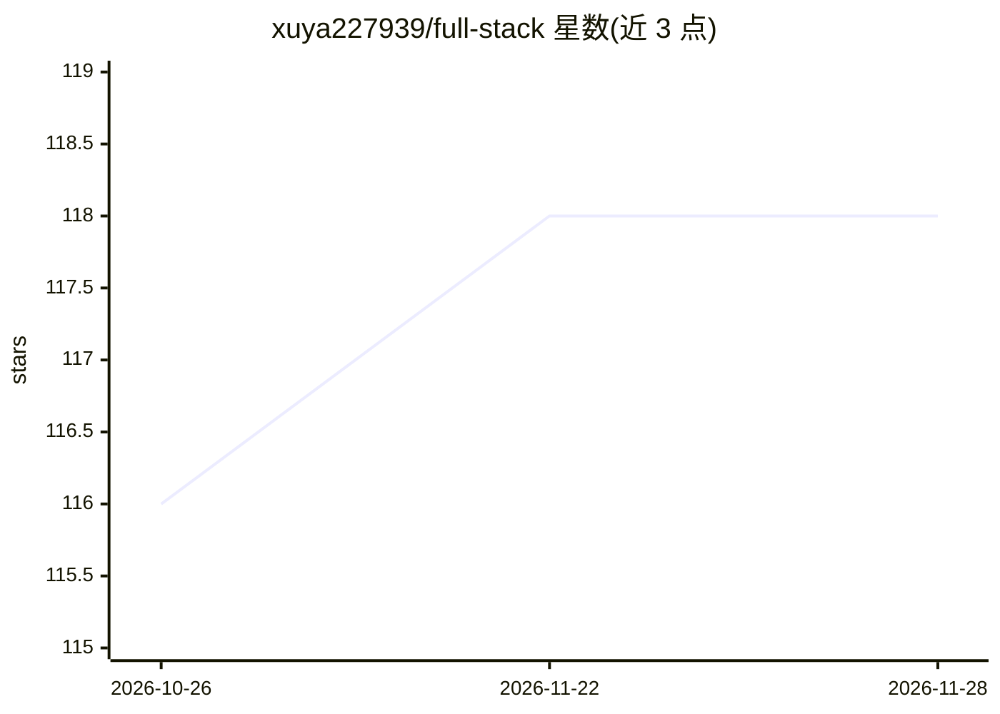

# xuya227939/full-stack

⭐ 118 · TypeScript · 推送 2026-11-21 · [GitHub](https://github.com/xuya227939/full-stack) · [官网](https://course.jchencode.com) · 个人维护 · 中文 README

**全栈造站学习项目：Next.js+React 的 SaaS 模板与教程配套仓库**

基于 Next.js 16 与 React 19 的全栈项目，配套「造站计划」课程，主题为从零搭建网站、学习 SEO、网站变现与用 AI 辅助创作内容。项目提供 Web 前端与 API 路由、用户认证与 Supabase 数据访问、Stripe/支付宝支付链路、邮件发送、任务清理脚本、R2 存储与 Redis 支持、SEO 与多语言等功能。运行需 Node.js >=20.9 与 Bun >=1.2.x，并需按启用的功能配置 Supabase、Redis、支付渠道等环境变量。仓库还列出 SnapVee、SkillHub、Meshivo 3D 三个网站案例。

## 筛选速览

| 维度 | 判定 | 备注 |
|---|---|---|
| AI 角色 | `ai-enhanced` | 去掉 AI 部分产品仍成立 |
| 许可风险 | `none` | — |
| 部署形态 | `None` |  |
| 模型依赖 | — | README 未给出锁定关系 |
| 硬件要求 | — | 无带数字的原话,不猜 |
| 安装摩擦 | `low` | 无编译、无系统依赖或容器化 |
| 成熟度 | — | 结构信号不足 |

## 能力要点

- 覆盖认证（Supabase/NextAuth）、Stripe 与支付宝支付、邮件、存储、Redis 等全栈链路
- 提供 .env 多环境变量加载顺序规则与常见问题排查指南
- 包含 SEO 优化、博客内容与多语言处理
- 列出 SnapVee、SkillHub、Meshivo 3D 三个建站案例

## 适用场景

- 作为模板从零搭建带认证与支付的 SaaS 网站
- 学习 SEO、网站变现与 AI 辅助内容创作的课程配套实践
- 复用支付、邮件、存储等基础能力做二次开发

## 场景标签

`教程课程` · 领域:学习与行业

## 证据(README 行号)

> L3: 一个基于 Next.js 16 + React 19 的全栈项目。
> L8: > 从零搭建网站，学习 SEO、网站变现和用 AI 辅助创作内容。
> L16: - Web 前端与 API 路由

## 星数曲线

2026-10-26 116 → 2026-11-28 118（+2）

---
*卡片 v1 · prompt 1.4 · 生成 2026-11-28 · 置信度 high · 依据 README sha `74f08730d124` · [字段定义](../../DATASET.md)*
