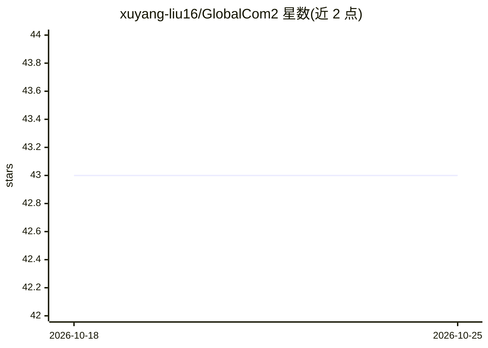

# xuyang-liu16/GlobalCom2

⭐ 43 · Python · Apache-2.0 · 推送 2026-01-27 · [GitHub](https://github.com/xuyang-liu16/GlobalCom2) · [官网](https://arxiv.org/abs/2501.05179) · 组织维护 · 中文 README

**高分辨率 LVLM 的免训练 token 压缩推理加速方法（AAAI 2026）**

面向高分辨率大型视觉语言模型（LVLM）的即插即用 token 压缩方法：从全局视角评估各 crop 的信息丰富度，据此分配保留比例并执行 token 压缩，去除冗余同时保留信息密集区域，实现免训练推理加速。基于 LLaVA 代码库实现，支持 LLaVA-NeXT-7B/13B，在 TextVQA、MME 等多模态基准上评测，唯一超参数为 retention_ratio（默认 0.25）。由四川大学、阿里巴巴等机构研究者发布，论文被 AAAI 2026 接收。

## 筛选速览

| 维度 | 判定 | 备注 |
|---|---|---|
| AI 角色 | `ai-ecosystem` | LLM/agent 周边工具 |
| 许可风险 | `permissive` | Apache-2.0 |
| 部署形态 | `library` | 以包/库形式分发 |
| 模型依赖 | — | README 未给出锁定关系 |
| 硬件要求 | — | 无带数字的原话,不猜 |
| 安装摩擦 | `low` | 无编译、无系统依赖或容器化 |
| 成熟度 | — | 结构信号不足 |

## 能力要点

- 全局视角评估 crop 重要性并分配保留比例的 token 压缩
- 免训练（training-free）、即插即用
- 单一超参数 retention_ratio 控制压缩程度
- 提供掩码与注意力分数可视化工具

## 适用场景

- 压缩高分辨率 LVLM 的视觉 token 以加速推理
- 在 TextVQA/MME 等多模态基准上评测压缩效果
- 可视化分析 token 压缩保留的区域

## 场景标签

`模型量化` · 领域:训练与推理

## 证据(README 行号)

> L26: > **TLDR:** We present GlobalCom 2 , a novel plug-and-play token compression method for high-resolution LVLMs that 
> L30: The two key functions in `llava/model/llava_arch.py` implement our global-guided local compression: **(a)** `genera

## 星数曲线

2026-10-18 43 → 2026-10-25 43（+0）

---
*卡片 v1 · prompt 1.4 · 生成 2026-10-25 · 置信度 high · 依据 README sha `6a4a750072a0` · [字段定义](../../DATASET.md)*
