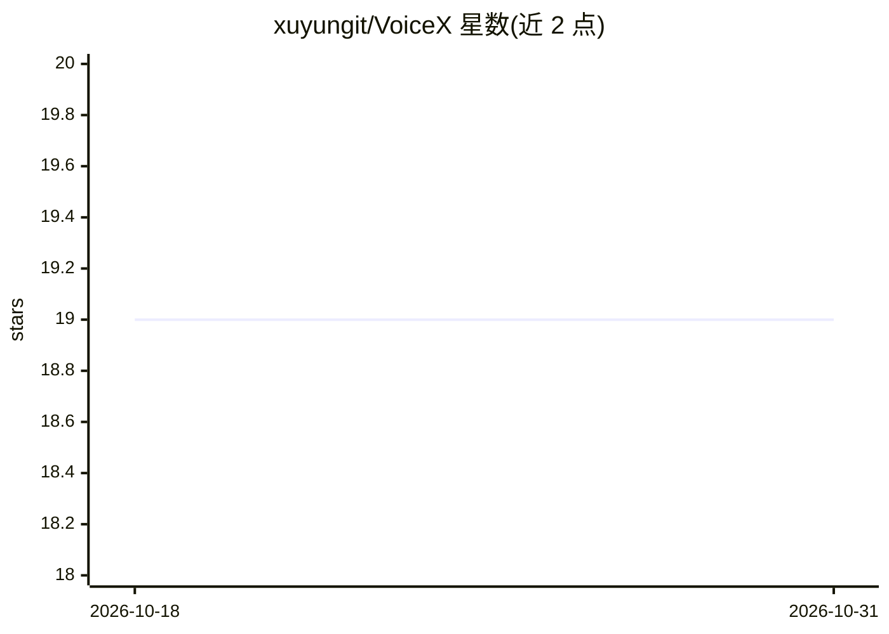

# xuyungit/VoiceX

⭐ 19 · Rust · MIT · 推送 2026-10-28 · [GitHub](https://github.com/xuyungit/VoiceX) · 个人维护 · 中文 README

**跨平台桌面语音工作台：在任意应用里语音听写、翻译与朗读**

Tauri 2 + Vue 3 构建的 macOS/Windows 桌面应用，覆盖语音→文字与文字→语音两个方向：全局热键驱动免提听写/按住说话/翻译三种模式，可在十四种云端与本地 ASR 引擎间切换，可选将识别结果交 LLM 纠错或翻译后注入当前应用；反向支持任意应用内选中文字朗读或翻译朗读，提供多家云端 TTS 与系统语音。附带实时 HUD、历史统计、词典热词、自建跨设备同步服务器和 voicex-tts 命令行 MP3 导出。面向终端用户，macOS 需授予辅助功能/输入监控/麦克风权限。

## 筛选速览

| 维度 | 判定 | 备注 |
|---|---|---|
| AI 角色 | `ai-native` | 本体是模型或模型工具 |
| 许可风险 | `permissive` | MIT |
| 部署形态 | `library` | 以包/库形式分发 |
| 模型依赖 | locked-api |  |
| 硬件要求 | — | 无带数字的原话,不猜 |
| 安装摩擦 | `low` | 无编译、无系统依赖或容器化 |
| 成熟度 | — | 结构信号不足 |

## 能力要点

- 单个全局热键三种模式：免提听写/按住说话/双击翻译
- 14 种云端与本地 ASR 后端，含完全离线的 Qwen3-ASR
- LLM 纠错/翻译后处理，自定义 prompt 模板与词典注入
- 任意应用内朗读与翻译朗读，附 voicex-tts 命令行 MP3 导出

## 适用场景

- 在编辑器、聊天等任意应用里用语音输入并自动纠错
- 阅读外文内容时选中文字直接翻译并朗读
- 用完全本地的 ASR 模型做隐私敏感的语音输入
- 多台设备间同步听写历史

## 场景标签

`语音识别` `语音合成` · 领域:内容生成

## 证据(README 行号)

> L9: VoiceX 是一个跨平台的桌面语音工作台，在任意应用里说、译、听。听写的处理链路为：录音、实时反馈、识别、按需纠正或翻译、把文本送进当前应用、保存并同步历史记录；反过来，选中的文字也可以直接读出来，或先翻译再朗读。听写部分和当下流
> L14: - **多 ASR 后端** — 在十四种云端和本地语音识别引擎间自由切换，兼顾准确率、延迟、语种覆盖和隐私。
> L18: - **LLM 后处理** — 可选将 ASR 输出交给大模型做纠错、翻译或润色，支持自定义 prompt 模板和词典上下文注入。

## 星数曲线

2026-10-18 19 → 2026-10-31 19（+0）

---
*卡片 v1 · prompt 1.4 · 生成 2026-10-28 · 置信度 mid · 依据 README sha `fb1ea4476220` · [字段定义](../../DATASET.md)*
