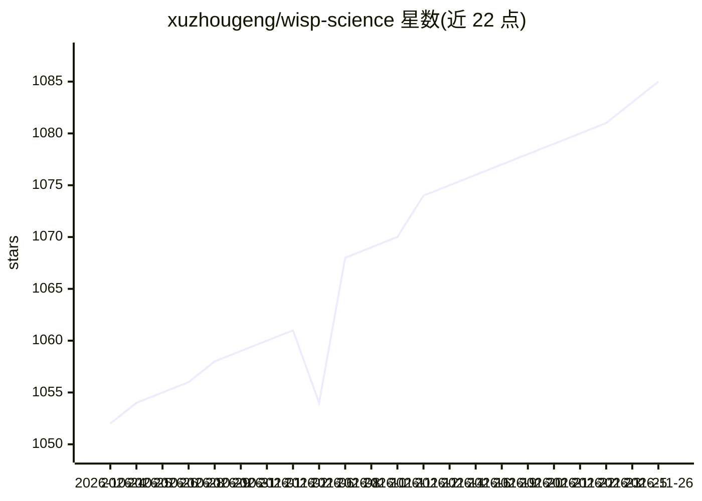

# xuzhougeng/wisp-science

⭐ 1,085 · Rust · AGPL-3.0 · 推送 2026-11-24 · [GitHub](https://github.com/xuzhougeng/wisp-science) · [官网](http://wispscience.com/) · 个人维护 · 中文 README

**本地优先的桌面 AI 科研工作台：检索、运行分析与留痕**

面向科研人员的本地优先桌面应用：支持文献检索、Python/R 内核运行、通过 MCP 服务器查询约 80 个科学数据库，并将图表、运行记录、决策与草稿保留在同一项目中。数据、对话与密钥保留在本地（密钥存于系统 keyring）。agent 读取/写入项目文件、运行 shell、加载 SKILL.md 技能，默认开启审批门。提供 Windows/macOS/Linux 安装包，可从源码构建，附带无需 API key 的 RNA-seq 演示。桌面开发正向统一 GPUI 前端迁移。

## 筛选速览

| 维度 | 判定 | 备注 |
|---|---|---|
| AI 角色 | `ai-native` | 本体是模型或模型工具 |
| 许可风险 | `viral` | AGPL-3.0 |
| 部署形态 | `desktop` | 安装包/桌面程序 |
| 模型依赖 | locked-api |  |
| 硬件要求 | — | 无带数字的原话,不猜 |
| 安装摩擦 | `low` | 无编译、无系统依赖或容器化 |
| 成熟度 | — | 结构信号不足 |

## 能力要点

- 通过捆绑 MCP 服务器查询 PubMed、GEO 等约 80 个科学数据库
- 持久 Python/R 内核，每会话隔离；支持本地、WSL、SSH 主机注册与长时运行提交
- Publication Workspace 将稿件修订固化为可验证 Evidence Capsules
- 默认开启审批门，密钥存于 OS keyring

## 适用场景

- 在一处完成文献检索、数据分析与图表生成并保留过程记录
- 通过 SSH 在远程服务器上提交长时间运行并查看实时日志
- 无 API key 情况下先用捆绑演示了解完整 RNA-seq 分析流程

## 场景标签

`数据分析` `科研工具` · 领域:效率与自动化

## 证据(README 行号)

> L23: Search the literature, run Python and R, query ~80 scientific databases, and
> L33: Bring OpenAI-compatible or Anthropic models, or drive Codex / Claude Code over
> L42: state. Register local, WSL, and SSH hosts once; probe hardware; submit

## 星数曲线

2026-10-24 1,052 → 2026-11-26 1,085（+33）

---
*卡片 v1 · prompt 1.4 · 生成 2026-11-24 · 置信度 high · 依据 README sha `0390dc7be9a0` · [字段定义](../../DATASET.md)*
