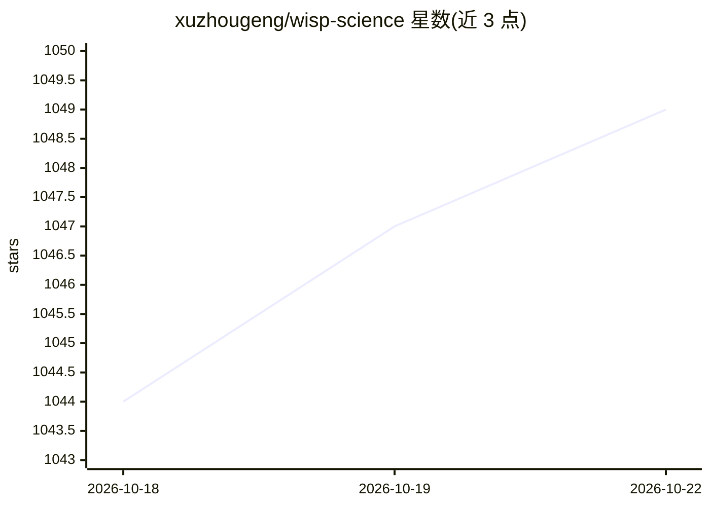

# xuzhougeng/wisp-science

⭐ 1,051 · Rust · AGPL-3.0 · 推送 2026-10-22 · [GitHub](https://github.com/xuzhougeng/wisp-science) · [官网](http://wispscience.com/) · 个人维护 · 中文 README

**本地优先的开源 AI 科研工作台：科学计算+文献检索**

桌面端科研工作台，面向需要结合 AI 与 Python/R 科学计算的研究者：接入 OpenAI 兼容或 Anthropic 模型，或通过 ACP 驱动 Codex / Claude Code；agent 可读写项目文件、运行 shell、加载 SKILL.md 技能。内置持久化 Python/R 内核、本地/WSL/SSH 运行时注册与长任务提交，通过打包 MCP 服务器接入 PubMed、GEO 等约 80 个科学数据库；提供 Evidence Capsules 手稿修订冻结与加密手动同步。AGPL-3.0-only 许可。

## 筛选速览

| 维度 | 判定 | 备注 |
|---|---|---|
| AI 角色 | `ai-native` | 本体是模型或模型工具 |
| 许可风险 | `viral` | AGPL-3.0 |
| 部署形态 | `desktop` | 安装包/桌面程序 |
| 模型依赖 | — | README 未给出锁定关系 |
| 硬件要求 | — | 无带数字的原话,不猜 |
| 安装摩擦 | `low` | 无编译、无系统依赖或容器化 |
| 成熟度 | — | 结构信号不足 |

## 能力要点

- 接入 OpenAI 兼容/Anthropic 模型或经 ACP 驱动 Codex / Claude Code
- 持久化 Python/R 内核，每个会话独立隔离内核
- 打包 MCP 服务器接入 PubMed、GEO 等约 80 个科学数据库
- Evidence Capsules 将手稿修订冻结为可验证证据；密钥存于系统钥匙串

## 适用场景

- 在本地完成文献检索、数据分析和写作的完整科研流程
- 把长时计算任务提交到 WSL 或远程 SSH/GPU 主机并查看实时日志
- 在隔离的 Exploration 中试错而不影响主线项目
- 将手稿修订与证据打包为可验证的 Evidence Capsule

## 场景标签

 · 领域:科学研究工具/AI 工作台

## 证据(README 行号)

> L33: Bring OpenAI-compatible or Anthropic models, or drive Codex / Claude Code over
> L40: Persistent Python and R kernels keep variables across cells and turns; each
> L47: PubMed, GEO, and ~80 other databases through bundled MCP servers. Offline

## 星数曲线

2026-10-18 1,044 → 2026-10-22 1,049（+5）

---
*卡片 v1 · prompt 1.4 · 生成 2026-10-21 · 置信度 high · 依据 README sha `787fdbc98388` · [字段定义](../../DATASET.md)*
