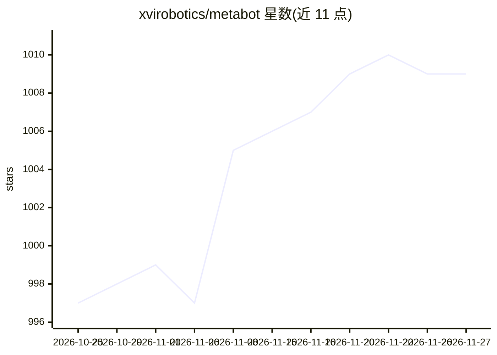

# xvirobotics/metabot

⭐ 1,009 · TypeScript · MIT · 推送 2026-10-26 · [GitHub](https://github.com/xvirobotics/metabot) · [官网](https://xvirobotics.com/metabot/) · 组织维护 · 中文 README

**从飞书/Telegram 手机端运行 Codex/Kimi Code 的个人 Agent 工作台**

可自托管的个人 Agent 工作台，由 XVI Robotics 开发、MIT 开源：通过一行安装脚本部署本地 Core、Web 控制台、IM Bridge 与 CLI，从飞书/Lark、Telegram、Slack、微信或 Web 使用 Codex、Kimi Code 等编码引擎，Claude Code 作为兼容引擎保留。提供 Agent Teams 并行分工、MetaMemory 跨会话记忆同步到飞书知识库、T5T/Goal 持久执行、Skill Hub 与 Agent Bus 消息机制。前置条件为 Node.js ≥ 22.19、Git 及引擎与渠道凭证。

## 筛选速览

| 维度 | 判定 | 备注 |
|---|---|---|
| AI 角色 | `ai-ecosystem` | LLM/agent 周边工具 |
| 许可风险 | `permissive` | MIT |
| 部署形态 | `library` | 以包/库形式分发 |
| 模型依赖 | — | README 未给出锁定关系 |
| 硬件要求 | — | 无带数字的原话,不猜 |
| 安装摩擦 | `low` | 无编译、无系统依赖或容器化 |
| 成熟度 | — | 结构信号不足 |

## 能力要点

- 三引擎接入：Codex 默认、Kimi Code 一级可选、Claude Code 兼容保留
- 飞书/Lark、Telegram、Slack、微信、Web 五种聊天渠道接入
- MetaMemory 跨会话记忆并可同步到飞书知识库
- 带签名校验的一行安装器，约五分钟部署完整个人版

## 适用场景

- 在飞书或 Telegram 手机端分派和跟进编码任务、合并 PR
- 搭建多 Agent 团队并行分工并保留持久任务状态
- 让 Agent 记忆跨会话留存并同步到飞书知识库

## 场景标签

`编码 Agent` `多智能体` `Agent 记忆` · 领域:Agent 开发

## 证据(README 行号)

> L3: ### 从飞书/Lark、Telegram、Slack、微信或 Web 使用 Codex 和 Kimi Code
> L53: |引擎|接入方式|认证|当前开源版能力|
> L136: - **移动端写代码** — 从聊天中改代码、跑测试、查看工具并跟进长任务。

## 星数曲线

2026-10-25 997 → 2026-11-27 1,009（+12）

---
*卡片 v1 · prompt 1.4 · 生成 2026-11-24 · 置信度 mid · 依据 README sha `7aa324b054fc` · [字段定义](../../DATASET.md)*
