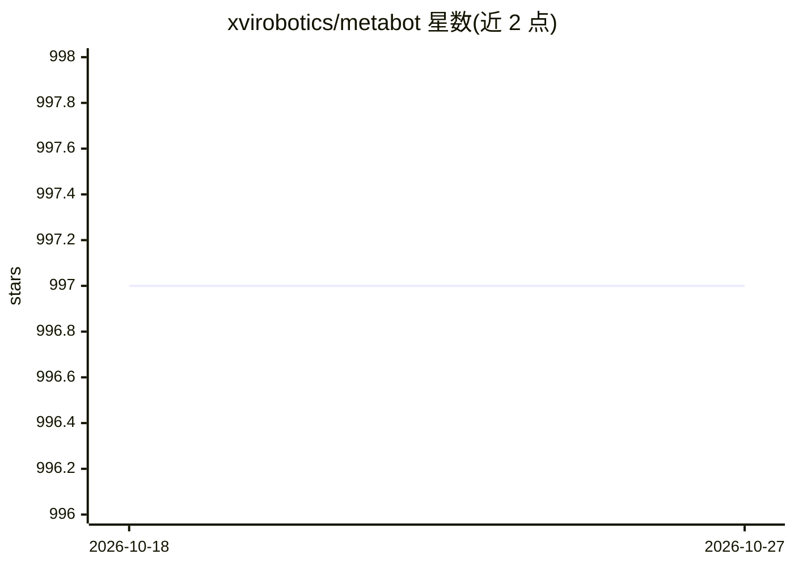

# xvirobotics/metabot

⭐ 997 · TypeScript · MIT · 推送 2026-10-26 · [GitHub](https://github.com/xvirobotics/metabot) · [官网](https://xvirobotics.com/metabot/) · 组织维护 · 中文 README

**自托管个人 Agent 工作台：从飞书/Telegram 等聊天端驱动编码 Agent**

可自托管、运行在用户自己机器上的个人 Agent 工作台：通过本地 Core、IM Bridge 和 Web 控制台，把 Codex CLI（默认引擎）、Kimi Code、Claude Code 兼容引擎接入飞书/Lark、Telegram、Slack、微信和浏览器 Chat。提供 Agent Teams 多 Bot 协作、跨会话 MetaMemory、Goal 持久任务、Skill Hub、T5T 看板和 Agent Bus 通信。一行 curl 安装器部署，需 Node.js >= 22.19 和至少一个引擎凭证；Agent 可在工作区读写执行代码，需自行控制暴露范围。

## 筛选速览

| 维度 | 判定 | 备注 |
|---|---|---|
| AI 角色 | `ai-ecosystem` | LLM/agent 周边工具 |
| 许可风险 | `permissive` | MIT |
| 部署形态 | `library` | 以包/库形式分发 |
| 模型依赖 | — | README 未给出锁定关系 |
| 硬件要求 | — | 无带数字的原话,不猜 |
| 安装摩擦 | `low` | 无编译、无系统依赖或容器化 |
| 成熟度 | — | 结构信号不足 |

## 能力要点

- Codex/Kimi Code/Claude Code 三引擎接入，每 Bot 独立选择引擎与工作区
- 飞书/Telegram/Slack/微信/Web 五类渠道，流式回复、工具执行与文件输出
- Agent Teams、MetaMemory、Goal 与 Agent Bus 持久化协作机制
- 一行安装器带签名校验，约五分钟部署本地 Core 与控制台

## 适用场景

- 在手机飞书/Telegram 里分派编码任务、跑测试并合并 PR
- 为不同项目配置混用引擎的多个 Bot 协作
- 跨会话沉淀知识并同步到飞书知识库

## 场景标签

`编码 Agent` `多智能体` `Agent 记忆` · 领域:Agent 开发

## 证据(README 行号)

> L3: ### 从飞书/Lark、Telegram、Slack、微信或 Web 使用 Codex 和 Kimi Code
> L51: Codex 是默认引擎，Kimi Code 是一级可选引擎。Claude Code 继续保留，确保现有 Claude Bot 和工作区仍能运行。
> L137: - **Agent Teams** — 创建专门队友、并行分工，保留持久的任务和运行状态。指南

## 星数曲线

2026-10-18 997 → 2026-10-27 997（+0）

---
*卡片 v1 · prompt 1.4 · 生成 2026-10-21 · 置信度 mid · 依据 README sha `39f618fe9cda` · [字段定义](../../DATASET.md)*
