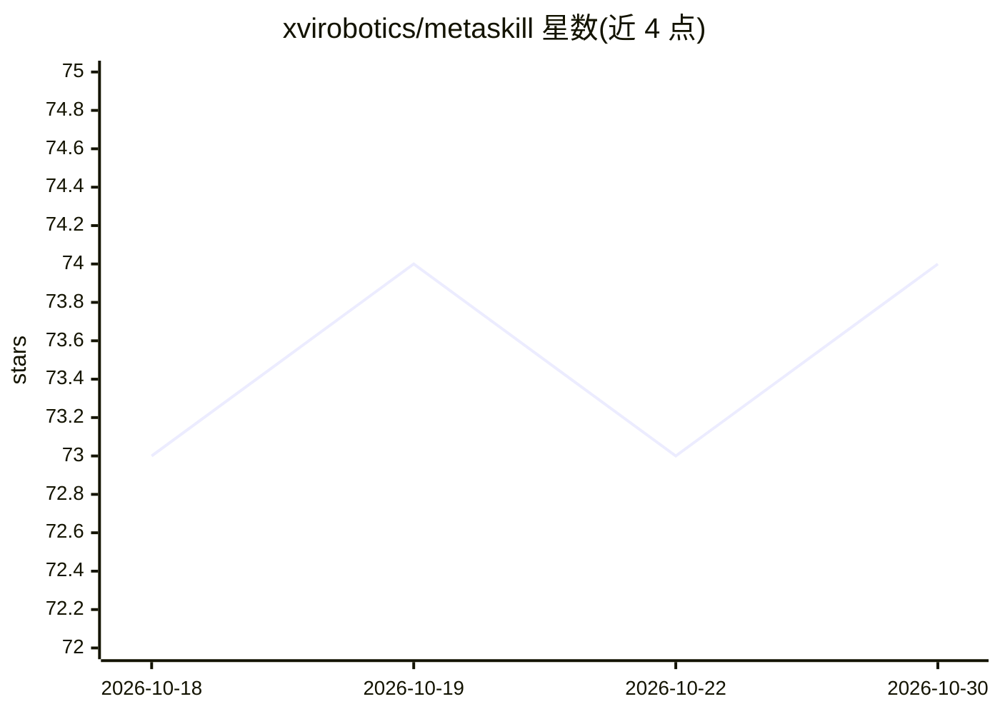

# xvirobotics/metaskill

⭐ 74 · Shell · MIT · 推送 2026-02-23 · [GitHub](https://github.com/xvirobotics/metaskill) · 组织维护

**一条命令生成 Claude Code 多智能体团队的元技能**

作为 Claude Code 的 skill 运行：通过 `/metaskill` 命令，根据项目描述自动生成完整 AI agent 团队（含 tech-lead 路由、专家 agent、code-reviewer 质量门、CLAUDE.md 路由协议与 .mcp.json MCP 服务器配置），也可生成单个 agent 或 skill。生成前执行网络调研阶段，检索该领域真实团队结构与 GitHub 上的既有 agent 配置，而非固定模板。要求本机已安装并认证 Claude Code CLI。附 fullstack-web、ios-app、data-science 三个可直接复制的示例团队。

## 筛选速览

| 维度 | 判定 | 备注 |
|---|---|---|
| AI 角色 | `ai-ecosystem` | LLM/agent 周边工具 |
| 许可风险 | `permissive` | MIT |
| 部署形态 | `None` |  |
| 模型依赖 | — | README 未给出锁定关系 |
| 硬件要求 | — | 无带数字的原话,不猜 |
| 安装摩擦 | `low` | 无编译、无系统依赖或容器化 |
| 成熟度 | — | 结构信号不足 |

## 能力要点

- 单命令生成含编排协议与质量门的多 agent 团队
- 生成前执行 Web 调研阶段以适配项目领域
- 按领域从 7 个已验证 MCP 服务器目录中选配并写入 .mcp.json
- 附 3 个可直接复制使用的完整示例团队

## 适用场景

- 为新项目快速搭建结构化的 Claude Code 多 agent 团队
- 生成具备角色 persona 与自验证系统提示的单个 agent
- 自动为项目配置合适的 MCP 服务器集合

## 场景标签

`Agent 框架` `多智能体` · 领域:Agent 开发

## 证据(README 行号)

> L10: Metaskill is a Claude Code skill that creates AI agent teams, individual agents, and custom skills — all through a 
> L88: ## The Idea

## 星数曲线

2026-10-18 73 → 2026-10-30 74（+1）

---
*卡片 v1 · prompt 1.4 · 生成 2026-10-24 · 置信度 high · 依据 README sha `3a20212cdfa3` · [字段定义](../../DATASET.md)*
