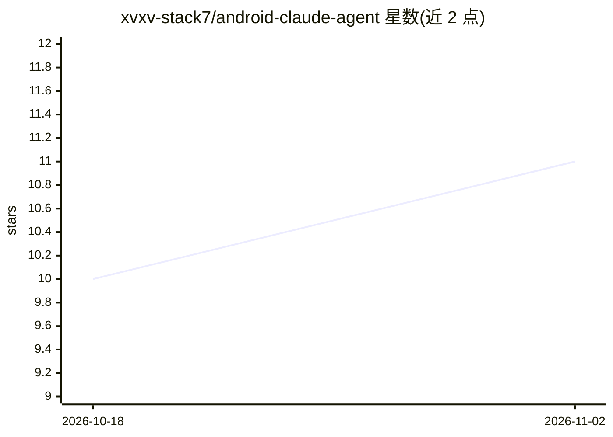

# xvxv-stack7/android-claude-agent

⭐ 11 · Shell · MIT · 推送 2026-09-30 · [GitHub](https://github.com/xvxv-stack7/android-claude-agent) · 个人维护 · 中文 README

**免 Root 免电脑让 Claude Code 在手机上感知并操控 Android**

运行于 Android + Termux 的 Claude Code 技能集与连接方案：用一次无线调试把 adbd 切到 TCP 5555 并锁定 127.0.0.1 回环，配合 Shizuku 提供 shell 权限，使 Claude Code 在无电脑、无网络情况下读取屏幕/前台应用/电量/短信/日历/传感器等状态并执行锁屏、杀应用、发通知、写日历等操作。采用事件触发型设计，传感器数据落盘为事件由 AI 按需消费。仅支持 Android（6.0+），不支持鸿蒙 NEXT 与 iOS，MIUI 需手动修复，手机重启后需重新执行跳板步骤。

## 筛选速览

| 维度 | 判定 | 备注 |
|---|---|---|
| AI 角色 | `ai-ecosystem` | LLM/agent 周边工具 |
| 许可风险 | `permissive` | MIT |
| 部署形态 | `None` |  |
| 模型依赖 | locked-api |  |
| 硬件要求 | — | 无带数字的原话,不猜 |
| 安装摩擦 | `low` | 无编译、无系统依赖或容器化 |
| 成熟度 | — | 结构信号不足 |

## 能力要点

- adb tcpip 5555 + 127.0.0.1 回环实现免电脑免网络的持久连接
- 提供 android-monitor、phone-control、phone-sensors 等 Claude Code 技能目录
- 事件触发型设计：传感器读数落盘为事件，consumed 标记防止重复投喂
- 26+ 传感器速查手册与多 OEM 前台应用检测回退方案

## 适用场景

- 让 Claude Code 在手机上边写代码边监控设备状态
- 让 AI 基于传感器与屏幕状态主动提醒或执行操作（如防沉迷、日历提醒）
- 在无 Root、无电脑的 Android 设备上搭建 AI 可操控的自动化环境

## 场景标签

 · 领域:移动端 AI Agent 工具

## 证据(README 行号)

> L3: **让你的 AI 摸到手机，而且自己会动。不用 Root，不用电脑，不用 WiFi。**
> L113: AI Agent（Claude Code）
> L245: ## 🤖 Claude Code 用户看这里

## 星数曲线

2026-10-18 10 → 2026-11-02 11（+1）

---
*卡片 v1 · prompt 1.4 · 生成 2026-11-02 · 置信度 high · 依据 README sha `d5f340ecfaf8` · [字段定义](../../DATASET.md)*
