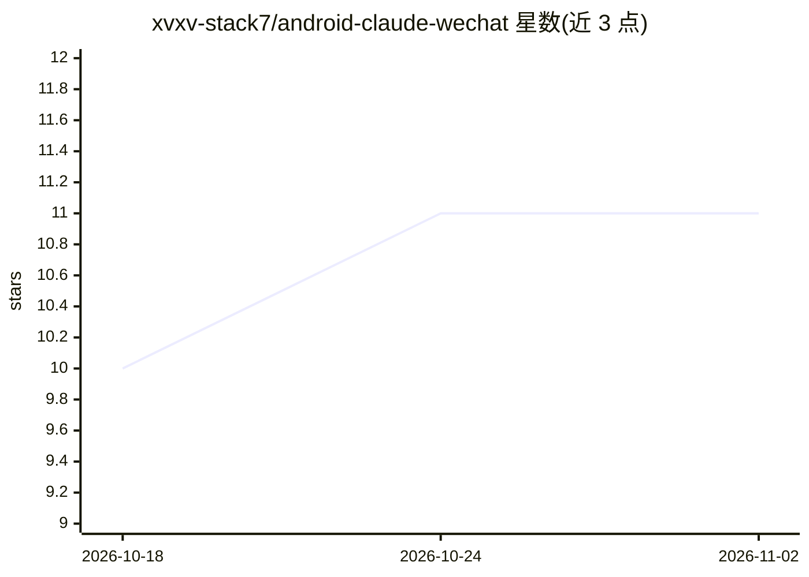

# xvxv-stack7/android-claude-wechat

⭐ 11 · Shell · MIT · 推送 2026-08-03 · [GitHub](https://github.com/xvxv-stack7/android-claude-wechat) · [官网](http://claudecode.miyohost.cn/) · 个人维护 · 中文 README

**一条命令在安卓 Termux 上运行 Claude Code 并接入微信**

面向无电脑用户的安装脚本集：在 Termux 中一键安装 Claude Code（预编译 arm64 二进制 v2.1.195，不经 npm、不依赖 Bun），并通过 cc-connect 经微信官方 ilink 协议接入微信，扫码后微信内即有一个可收发消息的 AI Agent。Gitee 版默认国内 API 与加速镜像，GitHub 版使用 Anthropic 默认配置。内置每日限额规避、DNS 修复、自动更新关闭；限制包括 ilink bot 官方限频、session 约 30 天过期需重新扫码。

## 筛选速览

| 维度 | 判定 | 备注 |
|---|---|---|
| AI 角色 | `ai-ecosystem` | LLM/agent 周边工具 |
| 许可风险 | `permissive` | MIT |
| 部署形态 | `None` |  |
| 模型依赖 | locked-api |  |
| 硬件要求 | — | 无带数字的原话,不猜 |
| 安装摩擦 | `low` | 无编译、无系统依赖或容器化 |
| 成熟度 | — | 结构信号不足 |

## 能力要点

- all-in-one.sh 一条命令完成安装并弹出微信扫码
- 预编译 claude-2.1.195-arm64 二进制（附 SHA-256），不依赖 Bun
- cc-connect 走微信官方 ilink 协议，不触碰微信 APK
- 内置国内镜像、每日限额规避与 proot DNS 修复

## 适用场景

- 只有安卓手机、想在微信里用上 Claude Code AI Agent
- 国内网络环境下免配置加速安装 Claude Code
- 在 Termux 上获得 Claude Code 终端环境而不接微信

## 场景标签

`编码 Agent` · 领域:编码与开发

## 证据(README 行号)

> L7: 在安卓手机（Termux环境）上运行Claude Code，通过cc-connect接入微信。装完后你的微信里会有一个AI Agent——不是冷冰冰的客服，是你一手搭出来的"人"。
> L27: curl -sSL https://raw.githubusercontent.com/xvxv-stack7/android-claude-wechat/master/all-in-one.sh | bash

## 星数曲线

2026-10-18 10 → 2026-11-02 11（+1）

---
*卡片 v1 · prompt 1.4 · 生成 2026-11-01 · 置信度 high · 依据 README sha `af8f71945c97` · [字段定义](../../DATASET.md)*
