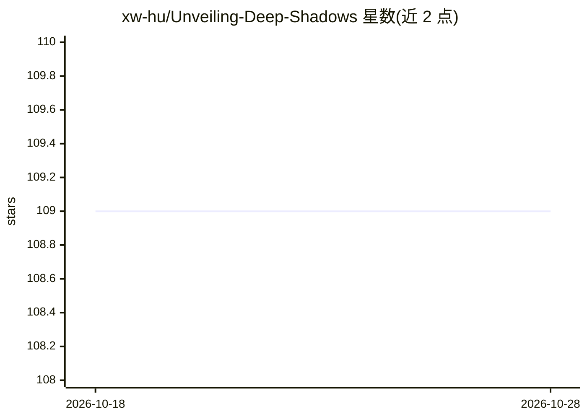

# xw-hu/Unveiling-Deep-Shadows

⭐ 109 · Python · 推送 2026-02-27 · [GitHub](https://github.com/xw-hu/Unveiling-Deep-Shadows) · [官网](https://arxiv.org/abs/2409.02108v3) · 组织维护 · 中文 README

**图像/视频阴影检测、去除与生成的综述与基准仓库**

配套 IJCV 2026 论文的综述与基准仓库：汇集近十年深度学习阴影分析的任务、模型、数据集与评测指标，在统一平台上对 DSC、BDRAR、DSDNet 等多种阴影检测方法进行公平比较（含 BER 指标、参数量与速度），并开展跨数据集泛化实验；提供各方法在 SBU-Refine、CUHK-Shadow 上的训练权重下载链接、修正标签后的数据集、BER 评测代码及论文列表。面向阴影分析方向的研究人员。

## 筛选速览

| 维度 | 判定 | 备注 |
|---|---|---|
| AI 角色 | `ai-knowledge` | 知识聚合/清单类 |
| 许可风险 | `none` | — |
| 部署形态 | `None` |  |
| 模型依赖 | — | README 未给出锁定关系 |
| 硬件要求 | — | 无带数字的原话,不猜 |
| 安装摩擦 | `low` | 无编译、无系统依赖或容器化 |
| 成熟度 | — | 结构信号不足 |

## 能力要点

- 统一平台下多种阴影检测方法的 BER/参数量/速度对比
- 跨数据集泛化评测（SBU-Refine 训练、SRD 测试）
- 提供各方法 256x256 与 512x512 输入的训练权重与代码仓库链接
- 汇总 28 篇以上阴影检测方法论文与 SBU-Refine 等修正数据集

## 适用场景

- 查找阴影检测/去除/生成方向的论文与数据集
- 获取各方法的预训练权重与评测代码用于复现或对比
- 了解模型规模、速度与性能关系及跨数据集泛化表现

## 场景标签

`模型评测` `精选清单` · 领域:评测与运维

## 证据(README 行号)

> L11: This repository contains the results and trained models for deep-learning methods used in shadow detection, removal
> L14: + A Comprehensive Survey and Benchmark of Shadow Analysis in the Deep Learning Era.

## 星数曲线

2026-10-18 109 → 2026-10-28 109（+0）

---
*卡片 v1 · prompt 1.4 · 生成 2026-10-23 · 置信度 high · 依据 README sha `03508368d8e5` · [字段定义](../../DATASET.md)*
