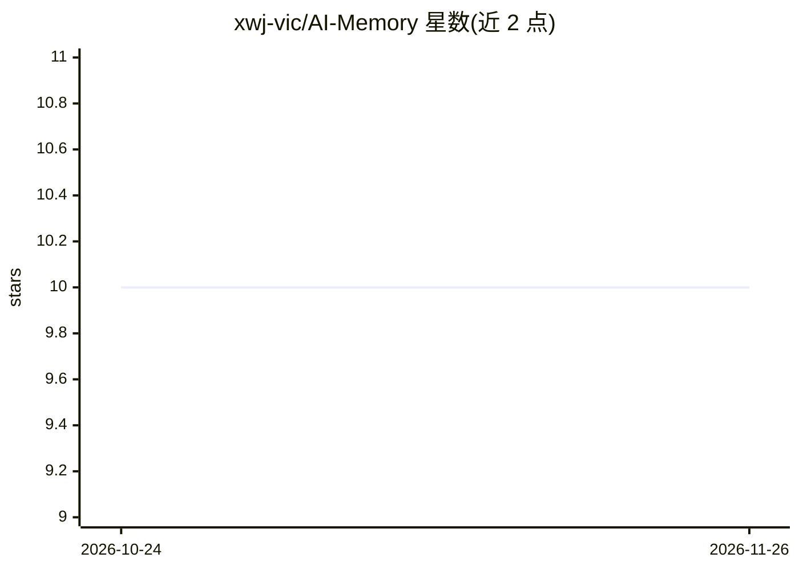

# xwj-vic/AI-Memory

⭐ 10 · Go · Apache-2.0 · 推送 2025-12-24 · [GitHub](https://github.com/xwj-vic/AI-Memory) · [官网](https://github.com/xwj-vic/AI-Memory/blob/main/README_CN.md) · 个人维护 · 中文 README

**给 AI Agent 提供仿生记忆管理的 Go 服务：STM→LTM 分层过滤与遗忘**

以 Go 后端 + Vue 管理面板实现的服务，为 AI Agent 管理对话记忆的生命周期：短期记忆存 Redis（默认 7 天 TTL），后台 LLM 评分过滤后晋升到 Qdrant 向量库的长期记忆，配合语义去重与基于艾宾浩斯遗忘曲线的自动衰减清理。提供 REST API（添加/检索记忆）、监控面板、告警规则配置与中英双语界面。运行依赖 Redis、MySQL、Qdrant 及 OpenAI 或兼容端点的 API Key。

## 筛选速览

| 维度 | 判定 | 备注 |
|---|---|---|
| AI 角色 | `ai-ecosystem` | LLM/agent 周边工具 |
| 许可风险 | `permissive` | Apache-2.0 |
| 部署形态 | `self-host` | docker 或自建部署 |
| 模型依赖 | — | README 未给出锁定关系 |
| 硬件要求 | — | 无带数字的原话,不猜 |
| 安装摩擦 | `low` | 无编译、无系统依赖或容器化 |
| 成熟度 | — | 结构信号不足 |

## 能力要点

- 三层漏斗架构：STM（Redis）→ Staging → LTM（Qdrant）
- LLM 多维评分做价值判断，重复跨会话验证与置信度分级
- 艾宾浩斯遗忘曲线自动衰减，半衰期可配置（默认 90 天）
- Web 管理面板：统计趋势、告警规则、中英双语切换

## 适用场景

- 给聊天型 Agent 加长期记忆，避免每次对话从零开始
- 控制记忆存储成本，自动丢弃低价值对话内容
- 通过面板监控和调整记忆系统的晋升与告警策略

## 场景标签

`Agent 记忆` · 领域:Agent 开发

## 证据(README 行号)

> L12: > A biomimetic AI memory management framework that implements a human-like funnel memory system (STM → Staging → LT
> L94: - **Multi-Store Coordination**: Redis (speed) + MySQL (structure) + Qdrant (semantics)
> L107: - **OpenAI API Key** (or compatible endpoint like SiliconFlow)

## 星数曲线

2026-10-24 10 → 2026-11-26 10（+0）

---
*卡片 v1 · prompt 1.4 · 生成 2026-11-19 · 置信度 high · 依据 README sha `62cb4b10a0de` · [字段定义](../../DATASET.md)*
