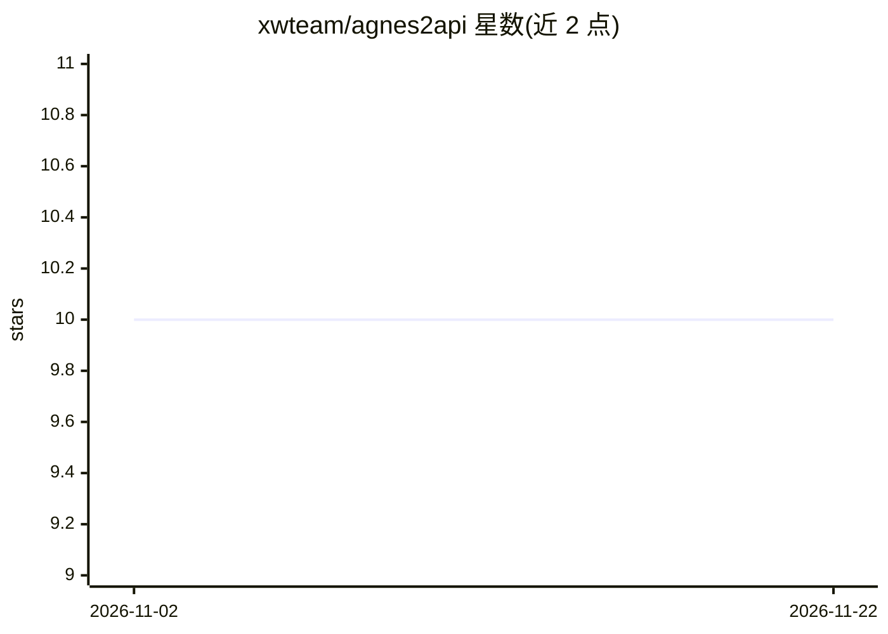

# xwteam/agnes2api

⭐ 10 · Rust · MIT · 推送 2026-09-14 · [GitHub](https://github.com/xwteam/agnes2api) · 个人维护 · 中文 README

**自托管多协议 AI 网关：四协议接入 Agnes 上游**

用 Rust + axum 实现的 API 中转网关，将 Agnes AI 后端封装为 OpenAI Chat、Anthropic Messages、OpenAI Responses、Gemini 四种 SDK 协议格式，官方 SDK 只改基址即可直连；支持对话、图片生成与视频生成（两段式任务）转发，四协议均支持 SSE 流式。内置 key 池自愈（分级冷却、永久剔除）与可选自动注册补池，以及默认关闭的 Web 管理面板。Docker 单镜像部署，全部状态落一份 store.json。仅限研究学习用途，README 提示可能不符合上游服务条款。

## 筛选速览

| 维度 | 判定 | 备注 |
|---|---|---|
| AI 角色 | `ai-ecosystem` | LLM/agent 周边工具 |
| 许可风险 | `permissive` | MIT |
| 部署形态 | `self-host` | docker 或自建部署 |
| 模型依赖 | — | README 未给出锁定关系 |
| 硬件要求 | — | 无带数字的原话,不猜 |
| 安装摩擦 | `low` | 无编译、无系统依赖或容器化 |
| 成熟度 | `idea` | |

## 能力要点

- 一套服务同时提供 OpenAI / Anthropic / OpenAI-Responses / Gemini 四种协议，官方 SDK 改基址直连
- key 池自愈：429/402 分级冷却、401/403 永久剔除、瞬时故障累计进入长冷却
- 可选注册机自动注册账号补池，两条临时邮箱通道平级
- fail-closed 鉴权：GATEWAY_TOKEN 必填，管理面板默认不注册

## 适用场景

- 让已用 OpenAI/Anthropic/Gemini SDK 的代码不经改动接入同一上游
- 自托管管理一个上游 API key 池并自动补池
- 通过管理面板查看用量、调试与逐模型连通性测试

## 场景标签

`模型网关` · 领域:Agent 开发

## 证据(README 行号)

> L5:  一套代码同时兼容 OpenAI / Anthropic / OpenAI-Responses / Gemini 四大 AI SDK，由 Agnes AI 后端统一供给对话与图片、视频生成，Docker 一条命令快速部署。
> L62: - 一个服务同时提供 **OpenAI Chat**、**Anthropic Messages**、**OpenAI Responses**、**Gemini 原生** 四种 SDK 格式，各协议官方 SDK 只改基址即可直连
> L99: - 基于 **Rust + axum**，一棵路由树装配四条协议、媒体转发与 `/admin` 子树

## 星数曲线

2026-11-02 10 → 2026-11-22 10（+0）

---
*卡片 v1 · prompt 1.4 · 生成 2026-11-19 · 置信度 high · 依据 README sha `e76aeb058137` · [字段定义](../../DATASET.md)*
