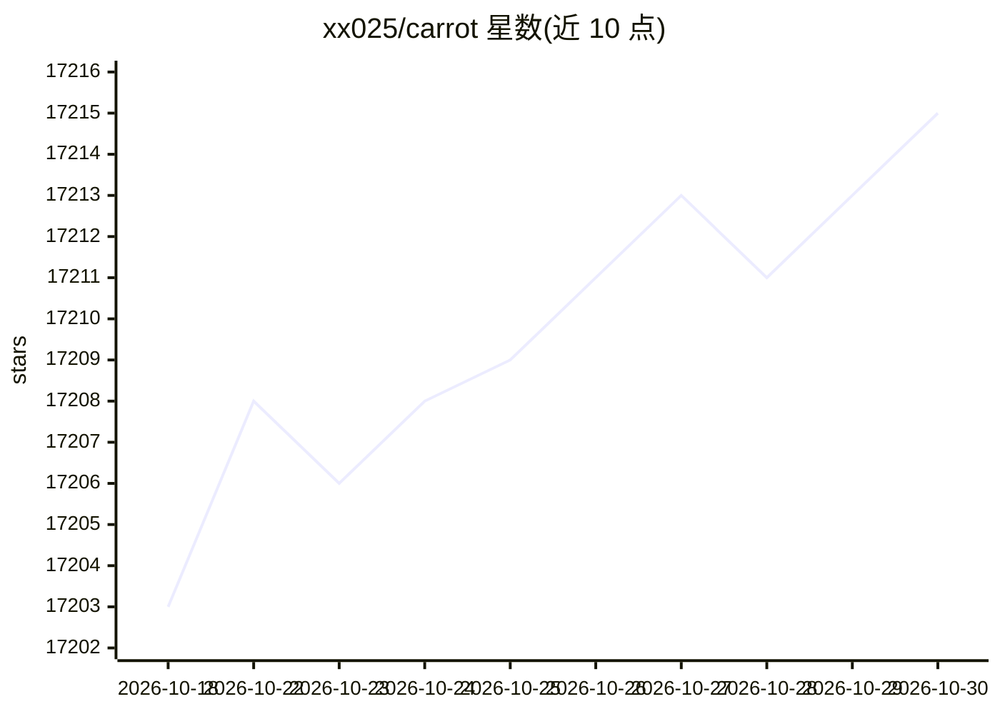

# xx025/carrot

⭐ 17,215 · 推送 2026-09-05 · [GitHub](https://github.com/xx025/carrot) · 个人维护 · 中文 README

**面向普通用户的 AI 工具网站导航清单，按类别收录可用站点**

以列表形式收录 AI 助手、Agent、开发工具、创作工具和行业应用类网站的导航目录，附发布网站与 Issues 反馈渠道。条目按「热门、通用助手与智能搜索、Agent 与自动化、模型/API 与算力、编程与开发工具、图像设计、音视频、写作办公」等类别组织，每条含名称、简介、链接及免费/需登录/需国际网络等标注。通过 Issues 接受站点提交、失效反馈与信息更正。未提供本地安装或运行方式。

## 筛选速览

| 维度 | 判定 | 备注 |
|---|---|---|
| AI 角色 | `ai-knowledge` | 知识聚合/清单类 |
| 许可风险 | `none` | — |
| 部署形态 | `None` |  |
| 模型依赖 | — | README 未给出锁定关系 |
| 硬件要求 | — | 无带数字的原话,不猜 |
| 安装摩擦 | `low` | 无编译、无系统依赖或容器化 |
| 成熟度 | — | 结构信号不足 |

## 动量与使用信号

- 维护:`active` — 距上次 push 42.5 天,年发版 0,1 位贡献者
- 涨星:近 1 天 **+1**(自 20261016 起算)
- 平台:— · 协议:OPENAI-API

## 能力要点

- 按用途分类的 AI 工具站点目录，含免费/需登录/需国际网络标注
- 覆盖助手、Agent、API 算力、编程、图像、音视频、写作办公等类别
- 通过 GitHub Issues 接收站点提交与失效反馈

## 适用场景

- 找免费可用的 ChatGPT 或国产大模型网页入口
- 按类别浏览 AI 编程、绘画、视频工具网站
- 发现自己收录站点失效时提交更正

## 场景标签

`精选清单` · 领域:学习与行业

## 证据(README 行号)

> L4: 这里收录了可用的 AI 助手、Agent、开发工具、创作工具和行业应用。
> L15: ## 热门
> L820: ## Agent 与自动化

## 星数曲线

2026-10-18 17,203 → 2026-10-30 17,215（+12）

---
*卡片 v1 · prompt 1.4 · 生成 2026-10-18 · 置信度 high · 依据 README sha `9723e96c6969` · [字段定义](../../DATASET.md)*
