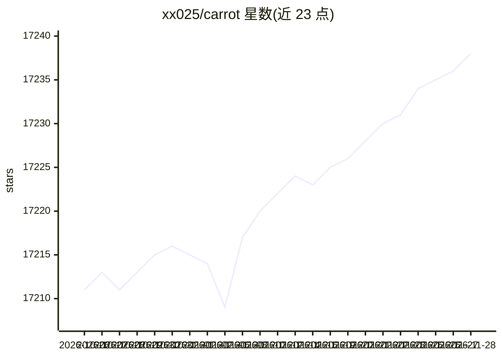

# xx025/carrot

⭐ 17,238 · 推送 2026-11-27 · [GitHub](https://github.com/xx025/carrot) · 个人维护 · 中文 README

**按使用场景分类的 AI 工具网站导航目录，方便查找和比较**

以分类清单形式收录 AI 相关网站，覆盖热门、通用助手与智能搜索、Agent 与自动化、模型 API 与算力、编程开发、图像音视频创作、写作办公、教育科研、营销与垂直应用等类别，每个条目附简介与标记（免费/需登录/需国际网络访问等）。读者通过点击站点名称访问目标网站，并通过页面提交新站点或反馈失效信息。收录条目的可用性以目标站点实际页面为准。

## 筛选速览

| 维度 | 判定 | 备注 |
|---|---|---|
| AI 角色 | `ai-knowledge` | 知识聚合/清单类 |
| 许可风险 | `none` | — |
| 部署形态 | `None` |  |
| 模型依赖 | — | README 未给出锁定关系 |
| 硬件要求 | — | 无带数字的原话,不猜 |
| 安装摩擦 | `low` | 无编译、无系统依赖或容器化 |
| 成熟度 | — | 结构信号不足 |

## 动量与使用信号

- 维护:`active` — 距上次 push 42.5 天,年发版 0,1 位贡献者
- 涨星:近 1 天 **+1**(自 20261016 起算)
- 平台:— · 协议:OPENAI-API

## 能力要点

- 按使用场景组织 12 个分类的站点清单
- 每条收录附免费额度、登录与网络条件标记说明
- 提供站点提交与失效反馈入口

## 适用场景

- 想按场景查找可用的 AI 网站工具
- 比较不同 AI 助手或 API 平台的免费额度与登录要求
- 为新增 AI 站点提交收录或纠错

## 场景标签

`精选清单` · 领域:学习与行业

## 证据(README 行号)

> L1: # AI55 · AI 工具导航
> L3: 这里收录 AI 助手、智能搜索、Agent、开发工具、创作工具和行业应用，按使用场景分类，方便查找和比较。
> L11:  热门 · 通用助手与智能搜索 · Agent 与自动化 · 模型、API 与算力 · 编程与开发工具 · 图像、设计与视觉创作 · 音频、视频与数字人 · 写作、办公与知识管理 · 学习、教育与科研 · 营销、商业与客户服务 ·

## 星数曲线

2026-10-26 17,211 → 2026-11-28 17,238（+27）

---
*卡片 v1 · prompt 1.4 · 生成 2026-11-28 · 置信度 high · 依据 README sha `a8abb5375c6b` · [字段定义](../../DATASET.md)*
