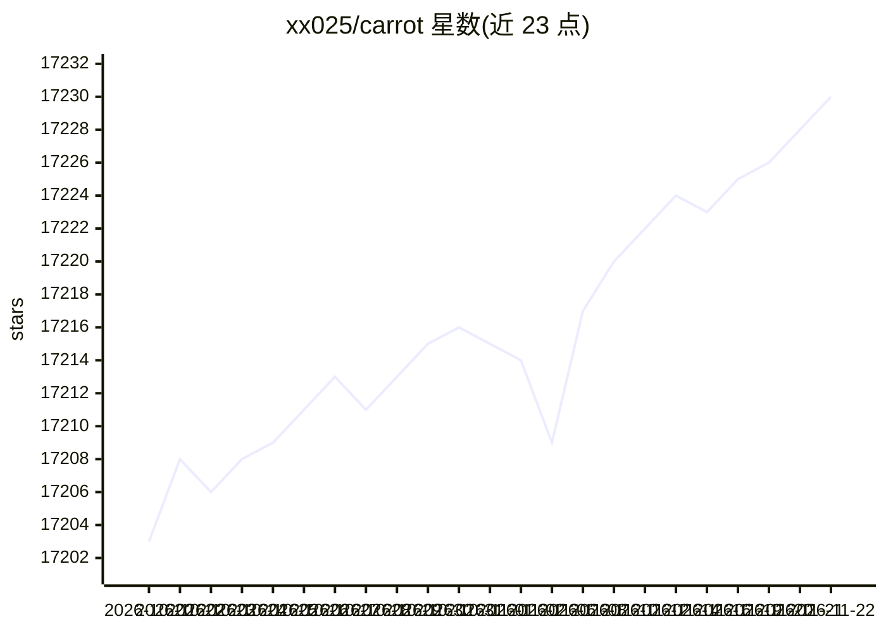

# xx025/carrot

⭐ 17,230 · 推送 2026-11-21 · [GitHub](https://github.com/xx025/carrot) · 个人维护 · 中文 README

**面向用户的 AI 工具站点分类导航清单**

以站点目录形式收录 AI 助手、智能搜索、Agent 与自动化、模型 API、编程与开发工具、图像/音视频创作等类别的网站，每条含站点名称、简介与可用性标记（免费/需登录/需国际网络等），按 12 个使用场景分类，用户通过浏览分类访问对应站点，并可提交新站点或反馈失效信息。清单中包含大量面向中国用户的免费/镜像类站点及 API 中转服务。

## 筛选速览

| 维度 | 判定 | 备注 |
|---|---|---|
| AI 角色 | `ai-knowledge` | 知识聚合/清单类 |
| 许可风险 | `none` | — |
| 部署形态 | `None` |  |
| 模型依赖 | — | README 未给出锁定关系 |
| 硬件要求 | — | 无带数字的原话,不猜 |
| 安装摩擦 | `low` | 无编译、无系统依赖或容器化 |
| 成熟度 | — | 结构信号不足 |

## 动量与使用信号

- 维护:`active` — 距上次 push 42.5 天,年发版 0,1 位贡献者
- 涨星:近 1 天 **+1**(自 20261016 起算)
- 平台:— · 协议:OPENAI-API

## 能力要点

- 按 12 个使用场景分类收录 AI 站点，含推荐/免费/需登录标记
- 覆盖通用助手、Agent、模型 API、编程工具、图像与音视频创作等类别
- 提供提交站点与失效反馈渠道
- 收录大量国内可直连的 AI 镜像站与 API 中转服务

## 适用场景

- 查找特定场景（写作、绘画、编程）可用的 AI 网站
- 寻找国内可直接访问的 AI 模型或 API 中转服务
- 比较不同 AI 助手与聚合平台的免费额度与登录要求

## 场景标签

`精选清单` · 领域:学习与行业

## 证据(README 行号)

> L1: # AI55 · AI 工具导航
> L3: 这里收录 AI 助手、智能搜索、Agent、开发工具、创作工具和行业应用，按使用场景分类，方便查找和比较。
> L13:  收录标记说明

## 星数曲线

2026-10-20 17,203 → 2026-11-22 17,230（+27）

---
*卡片 v1 · prompt 1.4 · 生成 2026-11-22 · 置信度 high · 依据 README sha `2883eec16107` · [字段定义](../../DATASET.md)*
