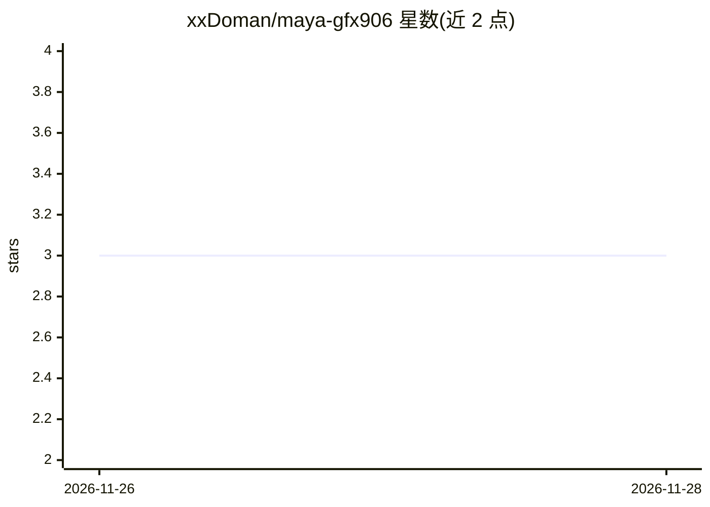

# xxDoman/maya-gfx906

⭐ 3 · Python · NOASSERTION · 推送 2026-11-27 · [GitHub](https://github.com/xxDoman/maya-gfx906) · 个人维护

**在 MI50/gfx906 上以 Docker 运行 DeepSeek-V4-Flash 的推理镜像**

面向 gfx906 架构显卡（MI50/MI60/Radeon VII）的 Docker 镜像：在为 gfx906 构建的 Strata 推理引擎之上运行上游 Maya dashboard（serve/server.py 未改动），修复了 deepseek4 pack 路径，附带单卡与双卡两份默认配置（IQ2_XXS 8k / IQ3_S 128k）。模型以 GGUF 分片 + pack 形式挂载到固定容器路径。暴露 dashboard（8092 端口）、/v1/chat/completions、/v1/messages、/metrics 等端点。依赖宿主机 --ulimit memlock=-1 以固定 RAM 专家层，双卡需同时设置 ROCR/HIP_VISIBLE_DEVICES 环境变量。

## 筛选速览

| 维度 | 判定 | 备注 |
|---|---|---|
| AI 角色 | `ai-ecosystem` | LLM/agent 周边工具 |
| 许可风险 | `none` | NOASSERTION |
| 部署形态 | `self-host` | docker 或自建部署 |
| 模型依赖 | — | README 未给出锁定关系 |
| 硬件要求 | — | 无带数字的原话,不猜 |
| 安装摩擦 | `low` | 无编译、无系统依赖或容器化 |
| 成熟度 | — | 结构信号不足 |

## 能力要点

- 提供单卡与 2×32 GB 双卡两份内置默认配置
- 暴露 OpenAI 风格 /v1/chat/completions 与 /v1/messages 端点
- 配置存于 volume，首次启动播种后不再覆盖
- 内置 llama.cpp 对比测量数据（13.3 vs 3.75 tok/s）

## 适用场景

- 在单张 MI50 32 GB 上本地运行 DeepSeek-V4-Flash
- 用两块 gfx906 卡跑 128k 上下文配置
- 给客户端提供兼容 API 端点的本地推理服务

## 场景标签

`推理引擎` · 领域:训练与推理

## 证据(README 行号)

> L22: `sha256:245c0d79b4bfa3ee7568398b5944aff545651c8a148ead2c8df01864d112113d`, 7.79 GB) — the upstream Maya
> L23: dashboard (`serve/server.py`, unmodified) on top of the Strata engine built for `gfx906`, with the
> L88: Then `http://<host>:8092/` for the dashboard, `/v1/chat/completions` and `/v1/messages` for clients,

## 星数曲线

2026-11-26 3 → 2026-11-28 3（+0）

---
*卡片 v1 · prompt 1.4 · 生成 2026-11-26 · 置信度 high · 依据 README sha `e544d5551c53` · [字段定义](../../DATASET.md)*
