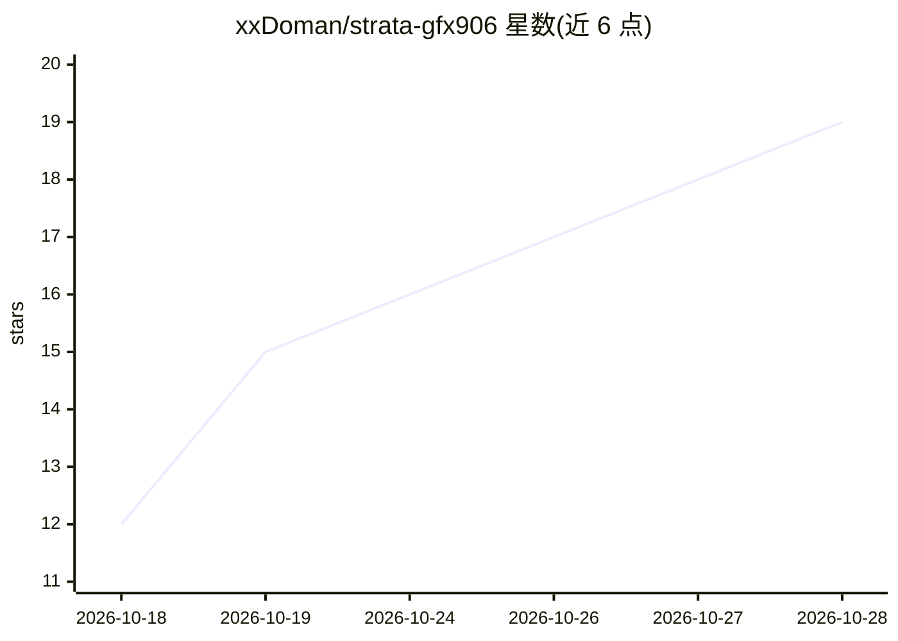

# xxDoman/strata-gfx906

⭐ 19 · Shell · MIT · 推送 2026-10-23 · [GitHub](https://github.com/xxDoman/strata-gfx906) · [官网](https://hub.docker.com/r/xxdoman/strata-mi50) · 个人维护

**面向 AMD gfx906（MI50/MI60/Radeon VII）的 Strata 推理引擎预构建 Docker 镜像**

将 Strata MoE 推理引擎打包为自包含 Docker 镜像（xxdoman/strata-mi50），目标硬件为 AMD gfx906 架构显卡（Instinct MI50/MI60 与 Radeon VII）。镜像内含引擎、服务器与浏览器配置器（端口 8090），内置官方 ROCm 镜像缺失的 gfx906 rocBLAS 内核与自研 GEMM 调优表（108 行，MI50 上调优）。附加改动包括恢复 Qwen3.6/Ornith（qwen35moe）引擎、DFlash2 构建修复、AVX2 基线的可移植 CPU 构建（无需 AVX-VNNI）。模型不打包进镜像，需从宿主机挂载；限制：DFlash2 草稿路径在此构建不可用，基准数字均来自单台机器且无第三方复现。

## 筛选速览

| 维度 | 判定 | 备注 |
|---|---|---|
| AI 角色 | `ai-ecosystem` | LLM/agent 周边工具 |
| 许可风险 | `permissive` | MIT |
| 部署形态 | `desktop` | 安装包/桌面程序 |
| 模型依赖 | — | README 未给出锁定关系 |
| 硬件要求 | — | 无带数字的原话,不猜 |
| 安装摩擦 | `low` | 无编译、无系统依赖或容器化 |
| 成熟度 | — | 结构信号不足 |

## 能力要点

- 单镜像集成引擎+服务器+浏览器配置器，内置 gfx906 rocBLAS 内核与调优表
- 恢复 Qwen3.6/Ornith（qwen35moe）引擎家族并附 MI50 实测吞吐数据
- AVX2 基线可移植 CPU 构建，修复无 AVX-VNNI 主机上的 SIGILL 崩溃
- 多版本标签（0.2.3/0.2.1/0.1.45/0.1.44.1）附 manifest 与引擎二进制校验和

## 适用场景

- 在 MI50/MI60/Radeon VII 上运行 Strata MoE 引擎做 LLM 推理而无需自行编译
- 用浏览器配置器在 :8090 配置并启动推理服务器
- 在旧 CPU（无 AVX-VNNI）主机上以 Docker 跑 gfx906 推理

## 场景标签

`推理引擎` · 领域:训练与推理

## 证据(README 行号)

> L3: Prebuilt, self-contained Docker image of the Strata MoE engine for AMD
> L8: One image = engine + server + configurator (**:8090**). No model is baked in — models, packs and the MTP

## 星数曲线

2026-10-18 12 → 2026-10-28 19（+7）

---
*卡片 v1 · prompt 1.4 · 生成 2026-10-28 · 置信度 high · 依据 README sha `500030f999e5` · [字段定义](../../DATASET.md)*
