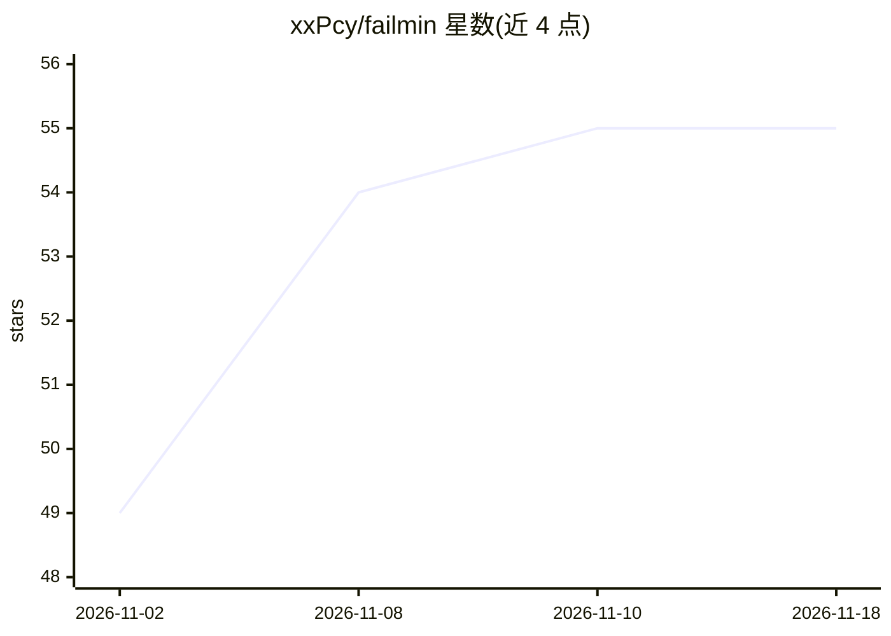

# xxPcy/failmin

⭐ 55 · Python · MIT · 推送 2026-09-27 · [GitHub](https://github.com/xxPcy/failmin) · 个人维护 · 中文 README

**将 AI/Agent 失败轨迹最小化为可复现短轨迹的调试工具**

对 LLM/Agent 运行轨迹应用 delta debugging 的 Python 库：反复删除消息、工具调用、检索结果、文件等轨迹事件并重放候选，仅保留仍能复现失败的删减，最终得到最小失败诱导上下文。提供框架无关的 Trace/TraceEvent 模型、依赖保持删减、层级粗到细最小化、概率性复现（runs+threshold）与重放缓存，输出 JSON/HTML 报告。内置 demo 确定性运行、无需 API key 与网络；Python 3.10–3.13 CI，v0.3 框架适配器（LangGraph/OpenAI）开发中。

## 筛选速览

| 维度 | 判定 | 备注 |
|---|---|---|
| AI 角色 | `ai-ecosystem` | LLM/agent 周边工具 |
| 许可风险 | `permissive` | MIT |
| 部署形态 | `library` | 以包/库形式分发 |
| 模型依赖 | — | README 未给出锁定关系 |
| 硬件要求 | — | 无带数字的原话,不猜 |
| 安装摩擦 | `low` | 无编译、无系统依赖或容器化 |
| 成熟度 | `idea` | |

## 能力要点

- 依赖感知的 ddmin 与层级粗到细最小化
- 概率性复现（runs + threshold）应对非确定性 LLM 运行，重放结果缓存
- 框架无关的 Generic JSON 轨迹格式与 Python API
- 零配置 CLI demo，无需 API key 与网络

## 适用场景

- 排查 RAG 管线中导致错误回答的关键检索片段
- 从长 Agent 轨迹中定位触发回归的必要事件
- 为 bug 报告生成最小可复现轨迹与 JSON/HTML 报告

## 场景标签

`LLM 可观测性` · 领域:评测与运维

## 证据(README 行号)

> L19: FailMin applies **delta debugging** to AI workflows. It repeatedly removes messages, tool calls, retrieval results,
> L35: Observability tells you **what happened**. FailMin tries to find the **smallest failure-inducing context**.

## 星数曲线

2026-11-02 49 → 2026-11-18 55（+6）

---
*卡片 v1 · prompt 1.4 · 生成 2026-11-18 · 置信度 high · 依据 README sha `cf4cd55fe74e` · [字段定义](../../DATASET.md)*
