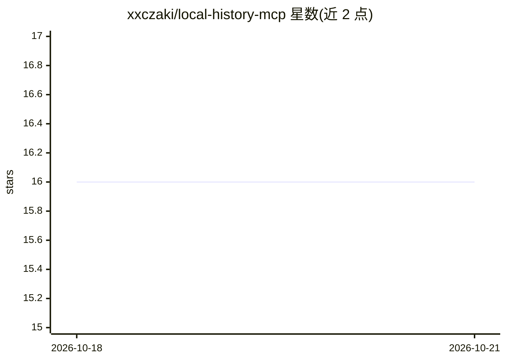

# xxczaki/local-history-mcp

⭐ 16 · TypeScript · MIT · 推送 2026-10-17 · [GitHub](https://github.com/xxczaki/local-history-mcp) · [官网](https://www.npmjs.com/package/local-history-mcp) · 个人维护

**让 AI 助手读取 VS Code/Cursor 本地历史的 MCP 服务器**

一个通过 Model Context Protocol 向 AI 助手开放编辑器 Local History 的 MCP server，覆盖 Cursor 与 VS Code 保存时点产生的文件快照。提供 6 个 MCP 工具：列出有历史的文件、查看单文件完整历史、读取指定历史条目、恢复文件到先前状态（带备份）、跨历史内容搜索与统计概览。安装途径为 npx 直接运行或从源码 git clone 后用 pnpm 构建，支持 Cursor 一键安装与 Claude Code CLI 注册。声明项目包含 LLM 生成代码（经人工审校）。

## 筛选速览

| 维度 | 判定 | 备注 |
|---|---|---|
| AI 角色 | `ai-ecosystem` | LLM/agent 周边工具 |
| 许可风险 | `permissive` | MIT |
| 部署形态 | `library` | 以包/库形式分发 |
| 模型依赖 | — | README 未给出锁定关系 |
| 硬件要求 | — | 无带数字的原话,不猜 |
| 安装摩擦 | `low` | 无编译、无系统依赖或容器化 |
| 成熟度 | — | 结构信号不足 |

## 能力要点

- 6 个 MCP 工具：列出/查看/读取/恢复/搜索/统计 Local History
- restore_from_history 恢复文件时自动创建备份
- npx 免安装运行，支持 Cursor 一键安装

## 适用场景

- 通过对话让 Claude/Cursor AI 帮我找回误改或丢失的代码版本
- 跨所有历史快照搜索某段代码的出处
- 让 AI 助手基于文件历史做数据恢复

## 场景标签

 · 领域:开发者工具/MCP 基础设施

## 证据(README 行号)

> L5: > Access Cursor/VS Code Local History through the Model Context Protocol for AI-powered data recovery
> L39: ## MCP Tools
> L60: ### Claude Code & Claude Desktop

## 星数曲线

2026-10-18 16 → 2026-10-21 16（+0）

---
*卡片 v1 · prompt 1.4 · 生成 2026-10-18 · 置信度 high · 依据 README sha `d5af2204f166` · [字段定义](../../DATASET.md)*
