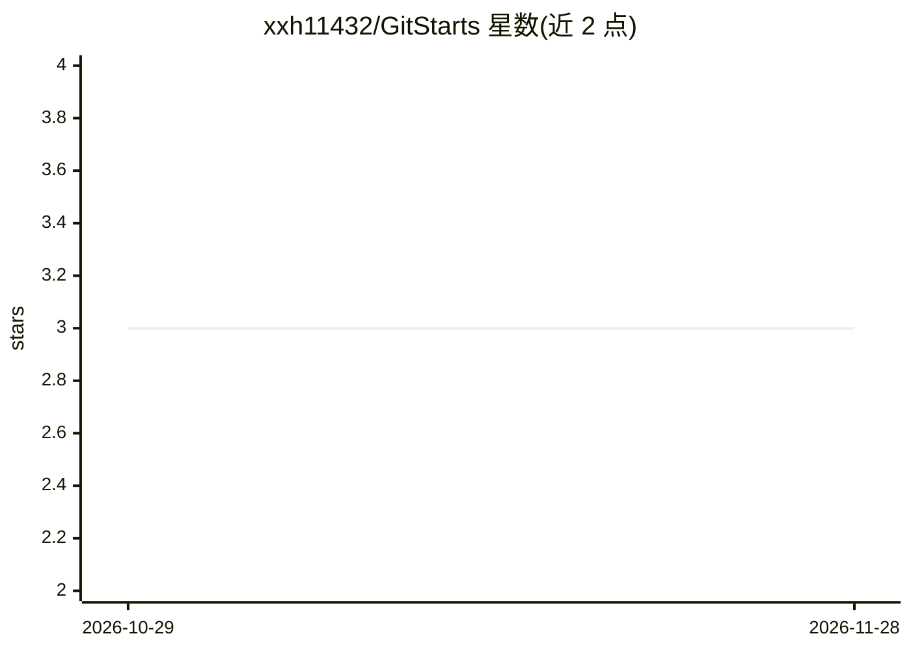

# xxh11432/GitStarts

⭐ 3 · Python · 推送 2026-11-15 · [GitHub](https://github.com/xxh11432/GitStarts) · 个人维护 · 中文 README

**用自然语言匹配与对比 GitHub 开源项目的选型平台**

从 GitHub 热门仓库聚合站演进的在线平台：定时采集仓库 star/fork/语言/topics 数据，用户以自然语言描述需求后经需求结构化、混合召回（MySQL 硬过滤 + Qdrant 向量召回 + BM25 加权 RRF）与 bge-reranker 精排输出候选，并支持 AI 深读 README、8 维逐格证据对比、对比历史与 Markdown 导出。部署采用 Docker Compose 编排 MySQL/Redis/后端/前端/Nginx，普通用户每日对话与对比有配额限制。

## 筛选速览

| 维度 | 判定 | 备注 |
|---|---|---|
| AI 角色 | `ai-native` | 本体是模型或模型工具 |
| 许可风险 | `none` | — |
| 部署形态 | `self-host` | docker 或自建部署 |
| 模型依赖 | — | README 未给出锁定关系 |
| 硬件要求 | — | 无带数字的原话,不猜 |
| 安装摩擦 | `low` | 无编译、无系统依赖或容器化 |
| 成熟度 | — | 结构信号不足 |

## 能力要点

- 自然语言需求结构化 + 语义召回 + rerank 精排，输出可解释契合度分解
- 8 维逐格证据对比（定位/技术栈/部署/许可/活跃度等），每格标注证据或「信息不足」
- AI 深读 README 与 manifest，SSE 流式对话与工具调用
- 每日配额、token 预算与成本看板等可观测机制

## 适用场景

- 有想法但不知道搜什么关键词时找现成开源项目
- 候选项目太多时按统一维度做横向对比
- 复盘开源选型过程（收藏、对比历史、导出）

## 场景标签

`RAG` `语义搜索` `推荐系统` · 领域:知识与检索

## 证据(README 行号)

> L19: 现在它正在演进为一个**开源方案匹配与对比平台**：
> L21: > 我有一个想法，但不知道有没有现成的开源项目 —— 用自然语言描述需求，拿到高契合度候选；候选太多不知道选哪个 —— 让 AI 读项目，按统一维度做横向对比，并为每个结论附上证据。
> L52: - **混合召回**：MySQL 硬过滤（严格，不放宽）→ 英文 `search_query` 归一化并拆成同品类子问题 → 每个子问题走 Qdrant 仓库级召回（含 README / manifest / repo_summa

## 星数曲线

2026-10-29 3 → 2026-11-28 3（+0）

---
*卡片 v1 · prompt 1.4 · 生成 2026-11-21 · 置信度 high · 依据 README sha `47dd630cf04e` · [字段定义](../../DATASET.md)*
