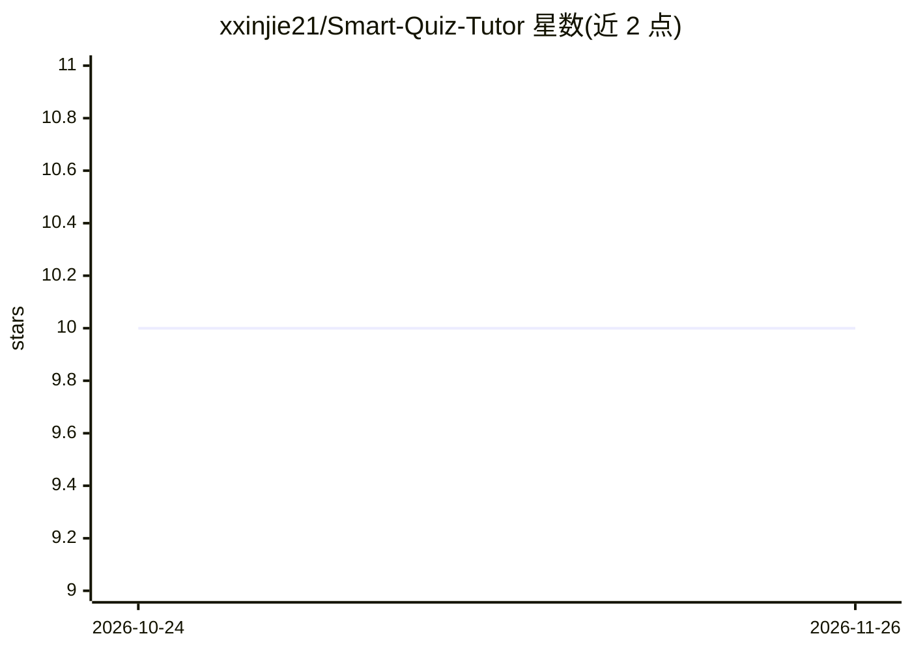

# xxinjie21/Smart-Quiz-Tutor

⭐ 10 · TypeScript · 0BSD · 推送 2026-09-22 · [GitHub](https://github.com/xxinjie21/Smart-Quiz-Tutor) · [官网](https://github.com/xxinjie21/Smart-Quiz-Tutor/releases) · 个人维护 · 中文 README

**Obsidian 笔记 AI 出题与 SM-2 间隔复习插件**

面向 Obsidian 用户的学习插件：读取本地 Markdown 笔记，通过本地 Ollama 或 OpenAI 兼容接口生成 5 种题型的试题，支持整卷识别（含 docx/PDF/图片）、答题即时批改、错题自动进入 SM-2 间隔复习循环。附带基于笔记检索的 AI 对话面板、知识点标签图谱、学习热力图，以及 Markdown/Word/PDF 导出。可配置接口地址、模型与温度；使用 Ollama 时数据不出本机，无遥测。

## 筛选速览

| 维度 | 判定 | 备注 |
|---|---|---|
| AI 角色 | `ai-native` | 本体是模型或模型工具 |
| 许可风险 | `permissive` | 0BSD |
| 部署形态 | `None` |  |
| 模型依赖 | local-ok | 支持本地模型 |
| 硬件要求 | — | 无带数字的原话,不猜 |
| 安装摩擦 | `low` | 无编译、无系统依赖或容器化 |
| 成熟度 | — | 结构信号不足 |

## 能力要点

- 5 种题型 AI 出题，整卷识别支持大文件分块
- SM-2 间隔复习：难度因子可调，附一键预设
- 内置检索式 AI 对话，检索范围可在插件库/整个 vault 间切换
- 知识点标签自动生成 MOC 索引并融入 Obsidian 图谱

## 适用场景

- 把 Obsidian 笔记转化为测验题自主刷题
- 错题按间隔重复排期复习
- 本地模型离线出题保护隐私

## 场景标签

`知识库管理` `文档解析` · 领域:知识与检索

## 证据(README 行号)

> L16: **Smart Question Tutor** turns your Obsidian Markdown notes into an active-study machine. It reads your local knowl
> L22: - Supports **Ollama** (local, private) and **OpenAI-compatible** endpoints (DeepSeek, etc.) via custom base URL, mo
> L37: ### Wrong Answer Book (SM-2 spaced repetition)

## 星数曲线

2026-10-24 10 → 2026-11-26 10（+0）

---
*卡片 v1 · prompt 1.4 · 生成 2026-11-19 · 置信度 high · 依据 README sha `18144c6b3a04` · [字段定义](../../DATASET.md)*
