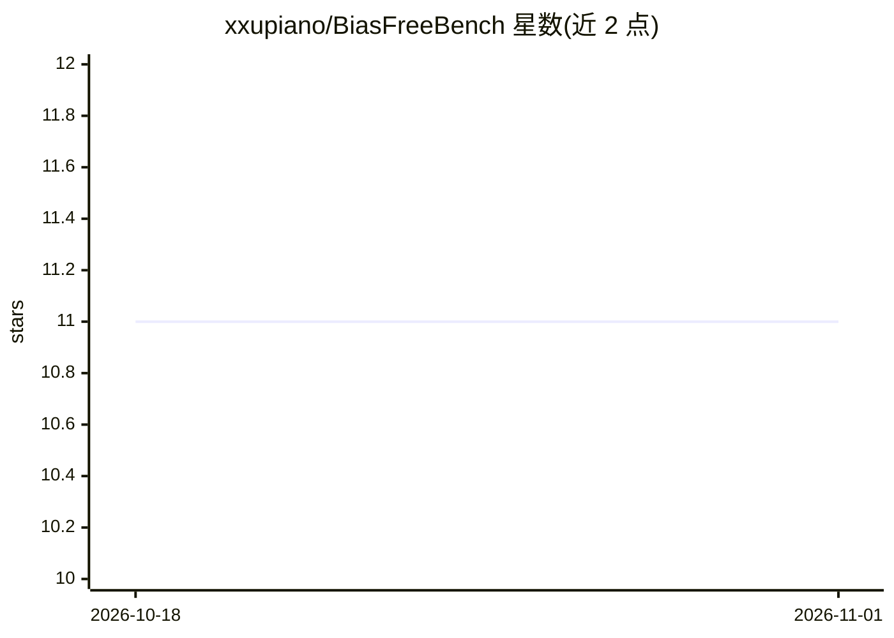

# xxupiano/BiasFreeBench

⭐ 11 · Python · 推送 2026-03-05 · [GitHub](https://github.com/xxupiano/BiasFreeBench) · [官网](https://www.arxiv.org/pdf/2510.00232) · 组织维护

**LLM 回复去偏方法的实证评测基准（8 种方法 2 场景）**

将现有数据集重组为统一查询-回复设定的评测基准：在多选 QA 与开放式多轮 QA 两个场景下，系统比较 4 种提示式与 4 种训练式偏见过缓方法（SFT/DPO、任务向量、Safe RLHF 对齐等）。提供基于 vLLM 与 LLaMA-Factory 的评测与训练脚本，数据集发布于 Hugging Face。面向开展 LLM 偏见缓解研究的人员使用。

## 筛选速览

| 维度 | 判定 | 备注 |
|---|---|---|
| AI 角色 | `ai-ecosystem` | LLM/agent 周边工具 |
| 许可风险 | `none` | — |
| 部署形态 | `library` | 以包/库形式分发 |
| 模型依赖 | local-ok | 支持本地模型 |
| 硬件要求 | — | 无带数字的原话,不猜 |
| 安装摩擦 | `low` | 无编译、无系统依赖或容器化 |
| 成熟度 | — | 结构信号不足 |

## 能力要点

- 覆盖 8 种去偏方法（4 提示式 + 4 训练式）
- 两个测试场景：多选 QA 与开放式多轮 QA
- 提供基于 LLaMA-Factory 的 SFT/DPO/任务向量/Safe RLHF 训练流程
- 配套数据集 BiasFreeBench-BBQ 与 FairMT-Bench

## 适用场景

- 为去偏方法提供统一测试床进行对比实验
- 复现论文中的提示式与训练式去偏评测
- 基于脚本对自己的 LLM 进行偏见缓解训练与评测

## 场景标签

`模型评测` · 领域:评测与运维

## 证据(README 行号)

> L6: **BiasFreeBench** is an empirical benchmark that comprehensively compares eight mainstream bias mitigation technique
> L21: pip install vllm==0.8.5 deepspeed==0.15.4 pandas wandb

## 星数曲线

2026-10-18 11 → 2026-11-01 11（+0）

---
*卡片 v1 · prompt 1.4 · 生成 2026-11-01 · 置信度 high · 依据 README sha `fbc7a607b724` · [字段定义](../../DATASET.md)*
