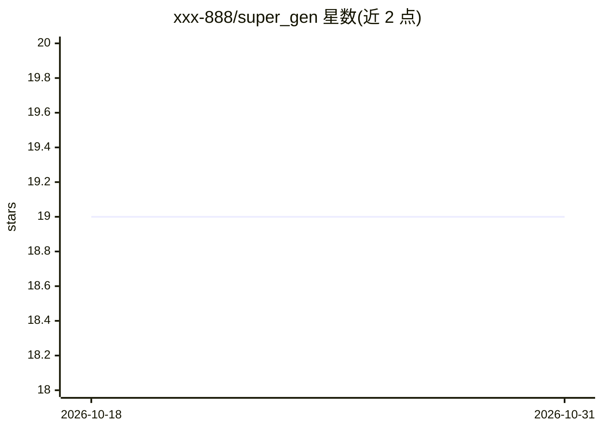

# xxx-888/super_gen

⭐ 19 · Python · 推送 2026-09-18 · [GitHub](https://github.com/xxx-888/super_gen) · [官网](https://ai.sdprcq.cc:8443) · 组织维护 · 中文 README

**面向短剧创作团队的 AI 短剧生成平台：剧本到成片全流程**

SceneGen 是一套 Web 端 AI 短剧生产平台，覆盖 LLM 剧本解析拆分镜、角色/场景/道具提取、@引用提示词编辑器、MiniMax-H3 r2va 多模态参考视频生成（参考图/视频/音频混合驱动）、React-Flow 节点画布编排、剪映式三轨道在线剪辑器与成片发布画廊。面向内容创作者、短视频团队与 MCN 机构，带多租户团队协作、积分计费与在线充值。后端 FastAPI + PostgreSQL/Redis，前端 React 18；模型渠道含智谱 GLM/CogView/CogVideoX、MiniMax 官方/CompShare/自部署 Ref2VA 与 ComfyUI 工作流；适配器统一抽象便于接入新厂商。Docker 拉起基础设施后从源码运行。

## 筛选速览

| 维度 | 判定 | 备注 |
|---|---|---|
| AI 角色 | `ai-native` | 本体是模型或模型工具 |
| 许可风险 | `none` | — |
| 部署形态 | `self-host` | docker 或自建部署 |
| 模型依赖 | — | README 未给出锁定关系 |
| 硬件要求 | — | 无带数字的原话,不猜 |
| 安装摩擦 | `low` | 无编译、无系统依赖或容器化 |
| 成熟度 | — | 结构信号不足 |

## 能力要点

- LLM 剧本解析自动拆分镜并提取角色/场景/道具入库
- MiniMax-H3 r2va 多模态参考生成（参考图≤9+视频≤3+音频≤3 混合驱动）
- @引用提示词编辑器 + React Flow 节点画布连线即引用
- 三轨道在线剪辑器（逐帧预览/变速/字幕烧录/ffmpeg 后台导出）与团队多租户积分计费

## 适用场景

- 把短剧剧本自动拆成分镜并生成视频成片
- 用节点画布串联提示词、生成与素材节点制作视频
- 团队内共享素材库、按积分计费管理生成任务用量

## 场景标签

`视频生成` `提示工程` · 领域:Agent 开发

## 证据(README 行号)

> L60: - **AI 剧本解析**：LLM 自动拆分镜（时长/运镜/景别/台词），角色、场景、道具一键提取入库
> L143: |图生视频 / 文生视频|**MiniMax-H3 官方 V2**、优云智算 CompShare、自部署 Ref2VA、智谱 CogVideoX|i2va / t2va / r2va（多模态参考）|
> L69: - ✅ **多模态参考生成（r2va）**：MiniMax-H3 官方渠道支持参考图片（≤9）+ 参考视频（≤3）+ 参考音频（≤3）混合驱动视频生成

## 星数曲线

2026-10-18 19 → 2026-10-31 19（+0）

---
*卡片 v1 · prompt 1.4 · 生成 2026-10-28 · 置信度 mid · 依据 README sha `04794c71084c` · [字段定义](../../DATASET.md)*
