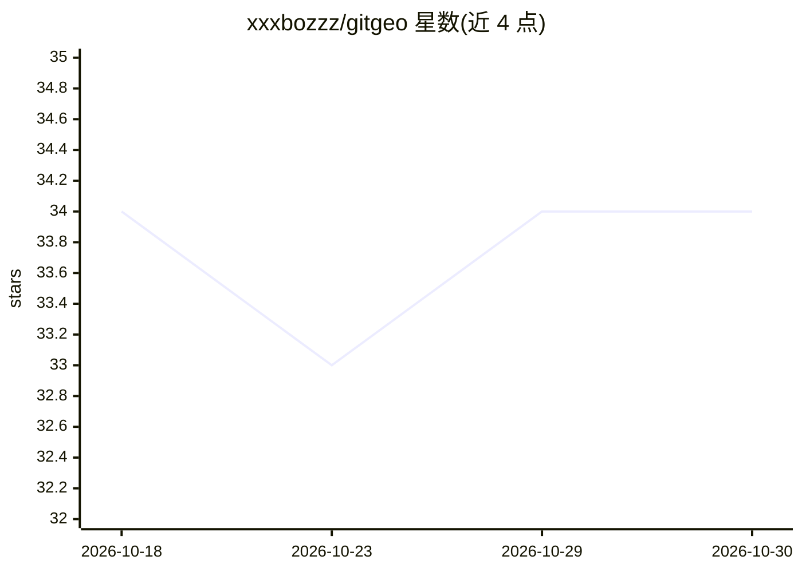

# xxxbozzz/gitgeo

⭐ 34 · Python · MIT · 推送 2026-05-22 · [GitHub](https://github.com/xxxbozzz/gitgeo) · [官网](https://www.pcbshenya.com/) · 组织维护 · 中文 README

**一站式 GEO 引擎：从关键词到 AI 可见性探测与自动发布的全流程**

面向个人生成式引擎优化（GEO）工作流的自托管引擎：关键词发现后经 6 Agent 流水线（Scout→Writer→Checker→Fixer→Linker→Prober）生成内容，9 维质检低于 80 分自动返修最多 3 轮；对 DeepSeek/豆包/Kimi/元宝 4 平台 × 桌面/移动 2 端共 8 通道探测品牌提及与引用标签，未命中标签写回下一轮 Prompt 约束。发布层基于 CloakBrowser（Playwright + 57 个 C++ 补丁）反检测浏览器，已实现知乎/微信公众号/DEV.to/Telegraph/DryRun 5 个适配器。后端 FastAPI + PostgreSQL 17 + pgvector + ChromaDB，含 Next.js 14 管理后台，Docker Compose 一键部署；LLM 通过 OpenAI 兼容 API 接入，需自备 GEO_LLM_API_KEY。项目源于四川深亚电子科技有限公司的内部业务需求。

## 筛选速览

| 维度 | 判定 | 备注 |
|---|---|---|
| AI 角色 | `ai-native` | 本体是模型或模型工具 |
| 许可风险 | `permissive` | MIT |
| 部署形态 | `self-host` | docker 或自建部署 |
| 模型依赖 | locked-api |  |
| 硬件要求 | — | 无带数字的原话,不猜 |
| 安装摩擦 | `low` | 无编译、无系统依赖或容器化 |
| 成熟度 | — | 结构信号不足 |

## 能力要点

- 8 个探测通道（4 平台 × 2 端）检测品牌提及与引用标签，结果写回 Prompt 闭环
- 9 维质检 + 自动返修（低于 80 分最多 3 轮）
- CloakBrowser 反检测发布层，5 个平台适配器，新平台仅需实现 4 方法的 Adapter
- 6 Agent 流水线 + 能力记忆层（12 组能力条目 + 11 条证据来源）

## 适用场景

- 批量生成并自动发布多平台内容，跟踪是否被 AI 引用
- 运营品牌在 DeepSeek/豆包/Kimi/元宝上的 AI 可见性
- 自托管一套带审计追踪的 GEO 内容工厂

## 场景标签

`浏览器自动化` `多智能体` `AI 写作` · 领域:Agent 开发

## 证据(README 行号)

> L20: gitgeo 是一套**完整的 GEO 工作流引擎**。大多数内容系统止步于「关键词 → 生成 → 发布」。gitgeo 多做了一步：**测量你的内容是否真的被 AI 引用，把测量结果反哺给下一轮生成。**
> L25: 关键词发现 → 证据采集 → Prompt 组装 → 9 维质检 → AI 探测（4 平台 × 2 端）
> L79: |AI 编排|6 Agent 流水线（Scout → Writer → Checker → Fixer → Linker → Prober）|

## 星数曲线

2026-10-18 34 → 2026-10-30 34（+0）

---
*卡片 v1 · prompt 1.4 · 生成 2026-10-25 · 置信度 high · 依据 README sha `3f9dc8540a85` · [字段定义](../../DATASET.md)*
