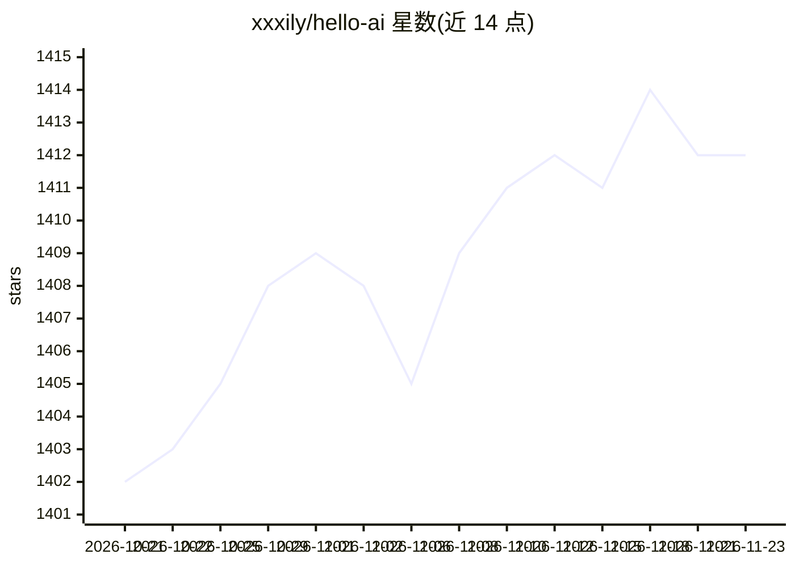

# xxxily/hello-ai

⭐ 1,412 · JavaScript · MIT · 推送 2026-10-30 · [GitHub](https://github.com/xxxily/hello-ai) · [官网](https://hello-ai.anzz.site/explore) · 个人维护 · 中文 README

**AI 自动维护的开源 AI 项目导航目录：发现、评估并分类 GitHub 项目**

一个由 AI Agent 自动维护的开源 AI 项目导航站与知识库框架：爬虫按 topics.json 种子主题遍历 GitHub API 收集 Stars≥500 的仓库，经 LLM 批量评估后自动打标签、生成中文描述并路由到动态分类；每日重算 Trending 榜单、按时效阈值清理过期项目，并通过 VitePress 动态渲染前端页面。提供 Node.js 脚本管线供本地部署运行，需配置 LLM API Key，支持 OpenAI 兼容接口及本地 Ollama。

## 筛选速览

| 维度 | 判定 | 备注 |
|---|---|---|
| AI 角色 | `ai-knowledge` | 知识聚合/清单类 |
| 许可风险 | `permissive` | MIT |
| 部署形态 | `library` | 以包/库形式分发 |
| 模型依赖 | local-ok | 支持本地模型 |
| 硬件要求 | — | 无带数字的原话,不猜 |
| 安装摩擦 | `low` | 无编译、无系统依赖或容器化 |
| 成熟度 | — | 结构信号不足 |

## 能力要点

- AI Agent 7×24 自动发现、评估并分类开源 AI 项目（已收录 26,519 个）
- 动态分类路由与中文描述自动生成，不合格项目进入隔离审计日志
- 支持任何 OpenAI 兼容 LLM API，内置 openai/minimax/deepseek/ollama 预设
- VitePress 前端随 projects.json 数据动态渲染导航栏与侧边栏

## 适用场景

- 在海量 GitHub 仓库中筛选并浏览高质量的 AI 开源项目
- 了解基础模型、Agent、RAG、基础设施等领域的项目版图
- 本地部署一套自动扩展的 AI 项目知识库目录

## 场景标签

`网页抓取` `精选清单` · 领域:效率与自动化

## 证据(README 行号)

> L3:  An intelligent, auto-updating directory of high-quality open-source projects.
> L46: **Hello-AI** is an **intelligent, AI-driven navigation hub for open-source AI projects.**
> L52: - 🤖 **Autonomous Smart Maintenance**: Unlike traditional link directories maintained manually, Hello-AI uses AI age

## 星数曲线

2026-10-21 1,402 → 2026-11-23 1,412（+10）

---
*卡片 v1 · prompt 1.4 · 生成 2026-11-23 · 置信度 high · 依据 README sha `a07b51aaa6cc` · [字段定义](../../DATASET.md)*
