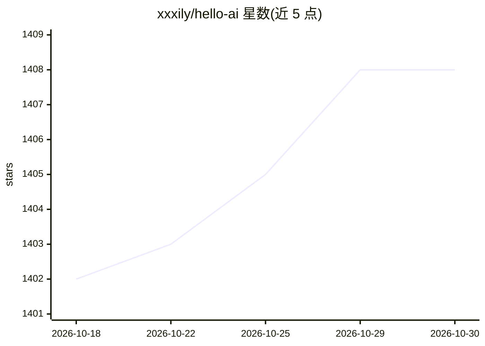

# xxxily/hello-ai

⭐ 1,408 · JavaScript · MIT · 推送 2026-10-24 · [GitHub](https://github.com/xxxily/hello-ai) · [官网](https://hello-ai.anzz.site/explore) · 个人维护 · 中文 README

**AI 自动维护的开源 AI 项目导航站，收录 2.6 万项目**

用 AI Agent 自动发现、评估、分类开源 AI 项目的导航站点与可本地运行框架：爬虫按种子主题遍历 GitHub API 抓取 Stars≥500 仓库，LLM 批量评估生成中文描述、标签并动态归类，剔除低质项目，经 VitePress 自动渲染静态页面。已收录 26195 个项目、12 大类，提供 Trending 榜与 Explore 仪表盘。支持 OpenAI/MiniMax/DeepSeek/Ollama 等 OpenAI 兼容端点，本地部署需 Node.js v18+，通过 npm 脚本运行发现-评估-生成闭环。

## 筛选速览

| 维度 | 判定 | 备注 |
|---|---|---|
| AI 角色 | `ai-knowledge` | 知识聚合/清单类 |
| 许可风险 | `permissive` | MIT |
| 部署形态 | `library` | 以包/库形式分发 |
| 模型依赖 | local-ok | 支持本地模型 |
| 硬件要求 | — | 无带数字的原话,不猜 |
| 安装摩擦 | `low` | 无编译、无系统依赖或容器化 |
| 成熟度 | — | 结构信号不足 |

## 能力要点

- AI Agent 自主发现、评估并分类开源项目，24/7 自动维护
- 已收录 26195 个项目，12 个类别，自动剔除长期未更新项目
- 支持任意 OpenAI 兼容 LLM 端点，含 Ollama 本地零成本方案
- VitePress 依据 projects.json 动态渲染导航与页面

## 适用场景

- 浏览和筛选高质量开源 AI 项目，找合适的工具
- 本地部署并自定义运行一套自动扩张的 AI 项目知识库框架
- 跟踪 GitHub 热门与近期活跃的 AI 仓库

## 场景标签

`精选清单` · 领域:学习与行业

## 证据(README 行号)

> L26: - 📁 **Total Collected**: 26195 projects
> L46: **Hello-AI** is an **intelligent, AI-driven navigation hub for open-source AI projects.**
> L52: - 🤖 **Autonomous Smart Maintenance**: Unlike traditional link directories maintained manually, Hello-AI uses AI age

## 星数曲线

2026-10-18 1,402 → 2026-10-30 1,408（+6）

---
*卡片 v1 · prompt 1.4 · 生成 2026-10-21 · 置信度 high · 依据 README sha `112baf4c9e84` · [字段定义](../../DATASET.md)*
