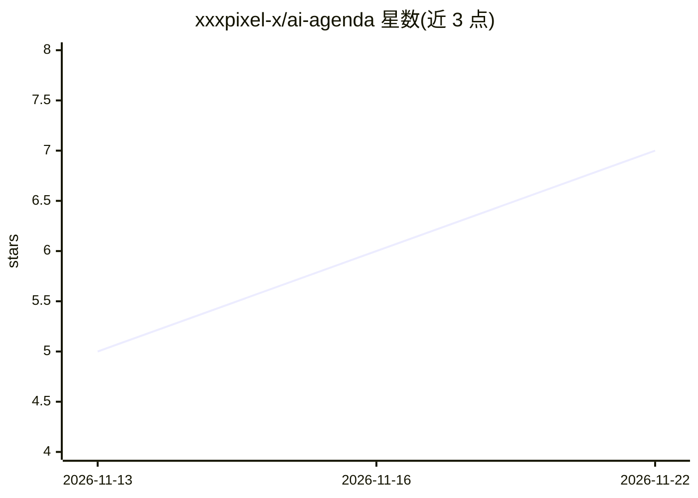

# xxxpixel-x/ai-agenda

⭐ 7 · JavaScript · MIT · 推送 2026-11-14 · [GitHub](https://github.com/xxxpixel-x/ai-agenda) · 个人维护 · 中文 README

**多 AI 协作桌面应用：多个 AI 同室讨论并共改文件**

基于 Electron 的桌面应用，将 Claude Code、Codex、Gemini、DeepSeek 等命令行 AI 与 API 模型放进同一空间：成员依次发言、@点名、按权限改共享文件夹，每次改动记录归属并支持对比与撤销。提供任务协作（计划确认后按依赖执行、Git worktree 并行合并）、其他 AI 软件对话导入与按主题交接简报、命令审批卡片。应用本身不带 AI，需本机登录的命令行工具或 API key；聊天记录存本机，权限依赖各 AI 自带工具限制，非操作系统级隔离。

## 筛选速览

| 维度 | 判定 | 备注 |
|---|---|---|
| AI 角色 | `ai-ecosystem` | LLM/agent 周边工具 |
| 许可风险 | `permissive` | MIT |
| 部署形态 | `desktop` | 安装包/桌面程序 |
| 模型依赖 | local-ok | 支持本地模型 |
| 硬件要求 | — | 无带数字的原话,不猜 |
| 安装摩擦 | `low` | 无编译、无系统依赖或容器化 |
| 成熟度 | `idea` | |

## 能力要点

- 多 AI 同一空间依次发言、互相接话，支持 @点名与轮次上限
- 共享文件夹改动记录归属，可对比与撤销（1 MiB 以下文本文件）
- 任务协作：计划确认 → 依赖执行 → 审查，Git 项目各 AI 在 worktree 并行
- 导入本机 Claude Code/Codex/Gemini CLI 等会话，按主题生成交接简报

## 适用场景

- 让多个 AI 在同一项目文件夹里分工改代码或写文档
- 把在 Claude Code 里做了一半的任务交给另一个 AI 接手
- 从多个 AI 工具导入对话并只挑一个主题写成简报交接

## 场景标签

`多智能体` · 领域:Agent 开发

## 证据(README 行号)

> L5: 你和几个 AI 的协作会议室。Claude Code、Codex、Gemini、DeepSeek 坐在同一张桌上讨论、分工，一起改同一个文件夹。写代码可以，写文档、论文、方案也可以。
> L15: 1. **连接 AI**：Agenda 本身不带 AI。你至少需要一个：本机装好并登录过的 Claude Code、Codex、DeepSeek Harness、Gemini CLI，或者一个 API key（Gemini、Dee
> L73: |AI|怎么接入|你需要做的|

## 星数曲线

2026-11-13 5 → 2026-11-22 7（+2）

---
*卡片 v1 · prompt 1.4 · 生成 2026-11-20 · 置信度 high · 依据 README sha `44eaaa8fb4eb` · [字段定义](../../DATASET.md)*
