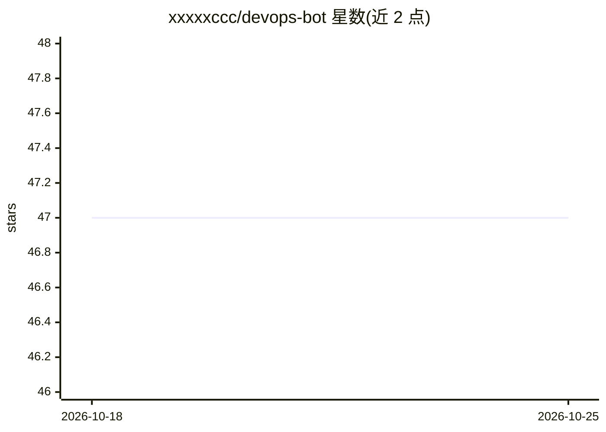

# xxxxxccc/devops-bot

⭐ 47 · TypeScript · MIT · 推送 2026-04-10 · [GitHub](https://github.com/xxxxxccc/devops-bot) · 个人维护 · 中文 README

**聊天驱动的 AI 编码代理：群聊提需求，自动改代码并提 PR**

面向开发团队的 IM 群聊编码机器人：接入飞书/Lark 或 Slack，在群内讨论需求后由 AI 自动执行代码修改并提交 Pull Request。核心机制为两级模型（快模型路由意图、强模型执行任务）、三级风险分层（低风险直接执行、中风险等审批、高风险仅建 Issue）、Git worktree 沙箱执行、AI PR 审查与最多 2 轮自动修复循环，并支持以 workspace 元仓模式管理组织内多个仓库。支持 Anthropic、OpenAI 及任意 OpenAI 兼容 API。提供一键安装脚本与源码安装两种方式。

## 筛选速览

| 维度 | 判定 | 备注 |
|---|---|---|
| AI 角色 | `ai-native` | 本体是模型或模型工具 |
| 许可风险 | `permissive` | MIT |
| 部署形态 | `library` | 以包/库形式分发 |
| 模型依赖 | locked-api |  |
| 硬件要求 | — | 无带数字的原话,不猜 |
| 安装摩擦 | `low` | 无编译、无系统依赖或容器化 |
| 成熟度 | — | 结构信号不足 |

## 能力要点

- 三级任务执行：AI 风险评估路由 execute/propose/issue 三档
- AI PR 审查与自动修复循环（最多 2 轮），审查记忆隔离并可反哺代码生成
- Workspace 模式：注册元仓 manifest 管理组织全部子项目，按需克隆
- 任务在 Git worktree 沙箱中执行，变更以 Draft PR 提交

## 适用场景

- 在飞书/Slack 群里讨论需求后让 AI 直接提交代码变更 PR
- 自动审查 PR 并修复发现的问题
- 通过 workspace 元仓统一管理组织多个仓库的 AI 编码任务

## 场景标签

`编码 Agent` `代码审查` · 领域:编码与开发

## 证据(README 行号)

> L7: Chat-driven AI coding agent — discuss requirements in group chat, get automated code changes and pull requests.
> L9: Supports multiple AI providers (Anthropic, OpenAI, and any OpenAI-compatible API) and multiple IM platforms (Feishu/

## 星数曲线

2026-10-18 47 → 2026-10-25 47（+0）

---
*卡片 v1 · prompt 1.4 · 生成 2026-10-25 · 置信度 mid · 依据 README sha `781db5f9db0d` · [字段定义](../../DATASET.md)*
