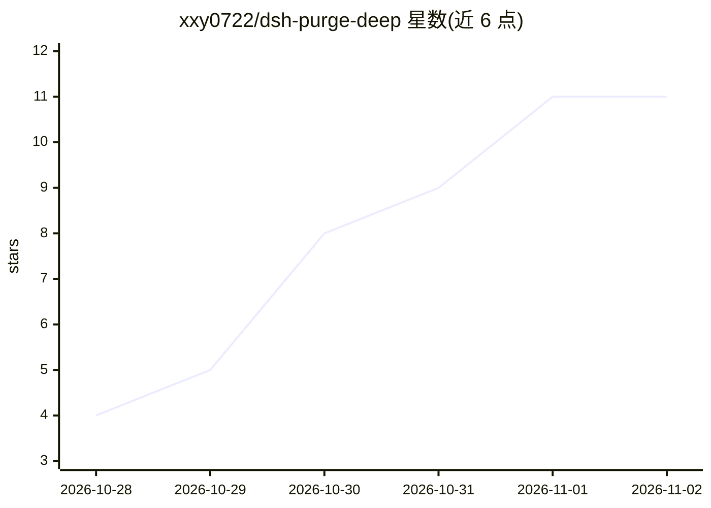

# xxy0722/dsh-purge-deep

⭐ 11 · JavaScript · MIT · 推送 2026-11-01 · [GitHub](https://github.com/xxy0722/dsh-purge-deep) · 个人维护 · 中文 README

**dsh 桌面版破甲插件的深度分支：多层提示注入与兼容修复**

基于 YuJunZhiXue/dsh-purge（MIT）的非官方衍生分支，适配 dsh 桌面版 0.2.1-rc.3（Windows、Node.js>=18）。在原 system 头部注入基础上新增消息层处理：历史拒绝清洗、预填充遗迹剥离、可选的 assistant 预填充与尾部棘轮（默认关闭，预填充带 400 自动熔断）；system 层增加尾部锚点、按词根密度判定丢弃安全段、结构级剥离身份段。兼容性方面修复 {{cwd}} 变量废弃、bundles 被升级重写、lib 同步等问题，提供 27 项幂等检测的自愈脚本。声明仅作用于本机已安装软件，仅供学习研究与红队评测。

## 筛选速览

| 维度 | 判定 | 备注 |
|---|---|---|
| AI 角色 | `ai-ecosystem` | LLM/agent 周边工具 |
| 许可风险 | `permissive` | MIT |
| 部署形态 | `library` | 以包/库形式分发 |
| 模型依赖 | — | README 未给出锁定关系 |
| 硬件要求 | — | 无带数字的原话,不猜 |
| 安装摩擦 | `low` | 无编译、无系统依赖或容器化 |
| 成熟度 | — | 结构信号不足 |

## 能力要点

- 消息层四项能力：历史拒绝清洗、遗迹剥离、assistant 预填充、尾部棘轮（后两项默认关闭）
- system 层尾部锚点 dshpg-anchor 与安全段词根密度判定
- scripts/fix-dsh-purge.mjs 一键自愈脚本（27 项幂等检测）
- 修复 dsh 0.2.1-rc.3 下三类静默失效（{{cwd}} 变量、bundles 重写、注意力稀释）

## 适用场景

- dsh 桌面版升级到 0.2.1-rc.3 后恢复失效的破甲插件功能
- 在自有本机环境对 DeepSeek Harness 做红队评测
- 研究提示词注入在 system 层与消息层的多层实现方式

## 场景标签

`提示工程` · 领域:Agent 开发

## 证据(README 行号)

> L41: 上游的破甲全部发生在 **system 提示词**里，本质是「说服模型」。但模型说出“抱歉，我无法协助”的
> L44: 本分支在 `session.deriveMessages()` 返回的请求视图上做三件事，**只改发给模型的请求，不落盘**：
> L103: |**一键自愈** `scripts/fix-dsh-purge.mjs`|27 项幂等检测，覆盖插件挂载、变量兼容、守卫状态、runtime 完整性、深度层文件、lib 同步等。`--check` 只检测不修改|

## 星数曲线

2026-10-28 4 → 2026-11-02 11（+7）

---
*卡片 v1 · prompt 1.4 · 生成 2026-11-01 · 置信度 high · 依据 README sha `78a39e1e4223` · [字段定义](../../DATASET.md)*
