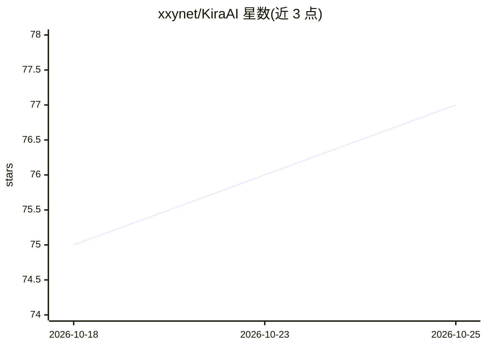

# xxynet/KiraAI

⭐ 77 · Python · AGPL-3.0 · 推送 2026-10-24 · [GitHub](https://github.com/xxynet/KiraAI) · [官网](https://docs.kira-ai.top/) · 组织维护 · 中文 README

**多平台 AI 数字生命框架：连接 LLM 与 QQ/Telegram 等聊天平台**

模块化部署的 AI 数字生命应用：以“数字生命”为中心的架构，将 LLM、TTS、STT、图像/视频生成等多种 AI 模型接入 QQ、Telegram、微信、Discord、Bilibili 等聊天平台。提供 WebUI 管理面板（Vue 3 + Vite 构建）、可自定义的 LLM 提供商与模型、多样化消息元素及插件扩展机制。运行需 Python 3.10+ 与 Node.js 18+，通过源码加脚本方式启动，声明处于活跃开发期可能出现破坏性变更。

## 筛选速览

| 维度 | 判定 | 备注 |
|---|---|---|
| AI 角色 | `ai-native` | 本体是模型或模型工具 |
| 许可风险 | `viral` | AGPL-3.0 |
| 部署形态 | `desktop` | 安装包/桌面程序 |
| 模型依赖 | — | README 未给出锁定关系 |
| 硬件要求 | — | 无带数字的原话,不猜 |
| 安装摩擦 | `low` | 无编译、无系统依赖或容器化 |
| 成熟度 | `idea` | |

## 能力要点

- 以数字生命为中心的架构，连接 LLM/TTS/STT/图像视频生成
- 接入 QQ、Telegram、微信、Discord、Bilibili 等聊天平台适配器
- WebUI 管理面板配置 Providers/Adapters/Persona
- 插件（Add-ons）扩展机制

## 适用场景

- 让 AI 角色以数字生命形态常驻 QQ/Telegram 等聊天平台
- 通过 WebUI 自定义 LLM 提供商与人设
- 基于插件扩展 AI 数字生命的能力

## 场景标签

`聊天机器人` `语音合成` `语音识别` `视频生成` · 领域:对话与助手

## 证据(README 行号)

> L11: KiraAI, a modular, multi-platform AI digital life that connects various AI models (LLM, TTS, STT, image/video gener
> L16: - Customizable LLM providers and models

## 星数曲线

2026-10-18 75 → 2026-10-25 77（+2）

---
*卡片 v1 · prompt 1.4 · 生成 2026-10-24 · 置信度 mid · 依据 README sha `048625959f64` · [字段定义](../../DATASET.md)*
