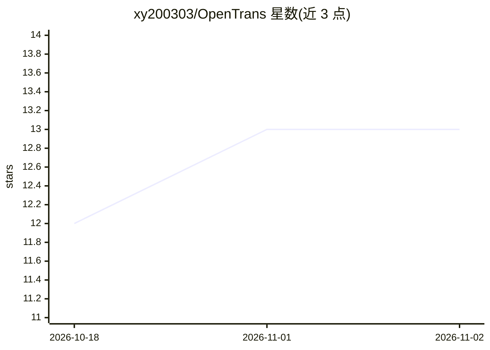

# xy200303/OpenTrans

⭐ 13 · Go · 推送 2026-06-11 · [GitHub](https://github.com/xy200303/OpenTrans) · [官网](https://opentrans.xyun.dev/) · 个人维护 · 中文 README

**Go 多协议 LLM 请求/响应/SSE 转换 SDK**

用 Go 编写的多协议适配层：将 OpenAI Chat Completions、OpenAI Responses、Anthropic Claude、Google Gemini 四种协议的请求体、响应体、流式事件先归一到 Request/Response/StreamEvent 标准化中间结构，再按目标协议重新输出。面向 LLM 网关、兼容层、代理层的开发者，提供 Gin 中间件、独立 Web 服务 opentransd（Docker 部署）、URL 一键转换与基准测试。限制：流式以文本增量、开始/结束、usage 为主，多模态输出与部分高级字段暂未完整映射。

## 筛选速览

| 维度 | 判定 | 备注 |
|---|---|---|
| AI 角色 | `ai-ecosystem` | LLM/agent 周边工具 |
| 许可风险 | `none` | — |
| 部署形态 | `self-host` | docker 或自建部署 |
| 模型依赖 | — | README 未给出锁定关系 |
| 硬件要求 | — | 无带数字的原话,不猜 |
| 安装摩擦 | `low` | 无编译、无系统依赖或容器化 |
| 成熟度 | — | 结构信号不足 |

## 能力要点

- 四种协议经标准化中间结构互转（请求/响应/SSE 流式事件）
- ginx 轻量 Gin 中间件做请求体、响应体、SSE 转换
- 独立服务 opentransd 支持浏览器表单与 Docker/docker compose 部署
- 提供基准测试目录与 PowerShell 测量脚本

## 适用场景

- API 网关做多模型供应商协议适配
- 开发 OpenAI/Claude/Gemini 兼容层与代理层
- 统一日志、审计、缓存与路由的协议预处理

## 场景标签

`模型网关` · 领域:Agent 开发

## 证据(README 行号)

> L3:  给 LLM 网关、兼容层和代理层使用的多协议请求体、响应体与 SSE 事件转换 SDK
> L33: OpenTrans 是一个用 Go 编写的多协议 LLM 适配层。它把 OpenAI Chat Completions、OpenAI Responses、Anthropic Claude、Google Gemini 的请求体、响应
> L37: - API 网关协议适配

## 星数曲线

2026-10-18 12 → 2026-11-02 13（+1）

---
*卡片 v1 · prompt 1.4 · 生成 2026-10-31 · 置信度 mid · 依据 README sha `4666bf29e2a1` · [字段定义](../../DATASET.md)*
