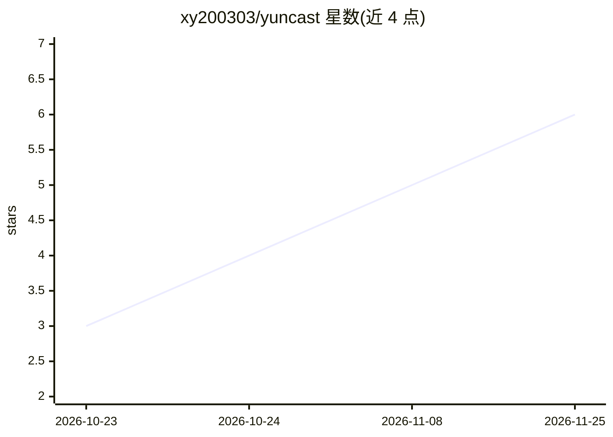

# xy200303/yuncast

⭐ — · [GitHub]() · 个人维护 · 中文 README

**面向不会直播的商家：AI 写稿配音自动回复评论的直播工作台**

Electron 桌面应用，把直播流程收进单窗口：导演 Agent 按项目场景逐段写底稿，用户逐条审改后用火山引擎/阿里云百炼 TTS 合成（支持 10–30 秒人声克隆），再经虚拟声卡或 FFmpeg 推流播出；评论经独立连接器接入，可开启自动响应让导演回复。数据按项目目录存储（SQLite+音频），可 ZIP 导入导出。仅提供 Windows 安装包，macOS/Linux 需自行打包；语言模型需自配 API 凭据。

## 筛选速览

| 维度 | 判定 | 备注 |
|---|---|---|
| AI 角色 | `ai-native` | 本体是模型或模型工具 |
| 许可风险 | `permissive` | — |
| 部署形态 | `desktop` | 安装包/桌面程序 |
| 模型依赖 | — | README 未给出锁定关系 |
| 硬件要求 | — | 无带数字的原话,不猜 |
| 安装摩擦 | `medium` | 含编译或系统依赖之一 |
| 成熟度 | — | 结构信号不足 |

## 能力要点

- 导演 Agent 按场景逐段写稿，写稿工具按语言校验
- TTS 支持 10–30 秒人声克隆，段落音色可覆盖
- 预合成/边播边合/实时三种合成时机，一直播模式播完自动续写
- 本机 MCP/命令行开放接口，可接入外部 AI Agent

## 适用场景

- 不会直播的商家用 AI 主播做商品宣讲和带货
- 把项目文档变成有声书或播客节目
- 直播中让 AI 自动回复评论区互动

## 场景标签

`语音合成` `AI 写作` · 领域:内容生成

## 证据(README 行号)

> L28: 把你手上的资料交给导演，它会按项目里定好的场景写一整版底稿；你逐条看、改、试听，满意就合成，然后开播。
> L50: |**声音**|火山引擎 / 阿里云百炼；克隆店家嗓音（10–30 秒干净人声）后整场使用，段落可单独覆盖|
> L90: - **语言模型**：一条接入 = 服务商 + 凭据 + 一组模型。支持 OpenAI 兼容（DeepSeek / 通义千问 / 豆包 / Kimi / 智谱）、OpenAI Responses、Anthropic，也能自定义地址

## 星数曲线

2026-10-23 3 → 2026-11-25 6（+3）

---
*卡片 v1 · prompt 1.4 · 生成 2026-11-21 · 置信度 high · 依据 README sha `060a3ffc420f` · [字段定义](../../DATASET.md)*
