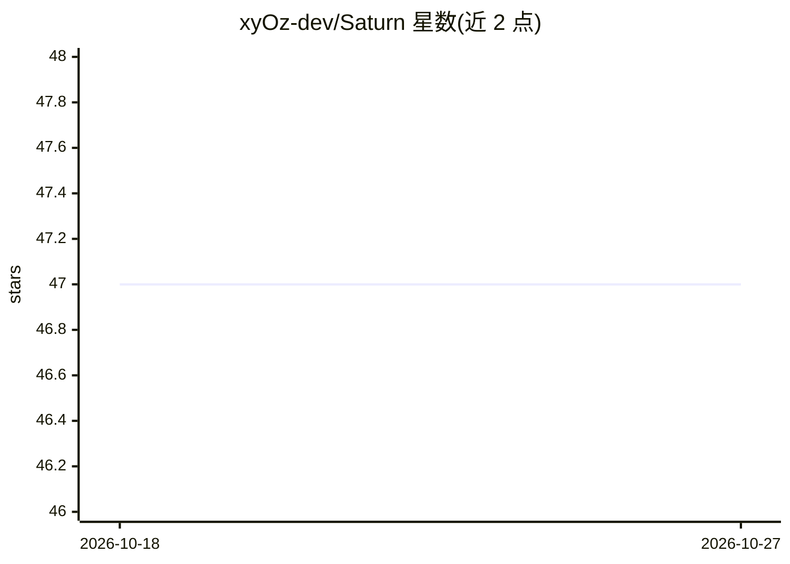

# xyOz-dev/Saturn

⭐ 47 · C# · 推送 2026-07-19 · [GitHub](https://github.com/xyOz-dev/Saturn) · [官网](https://discord.gg/VSjW36MfYZ) · 个人维护

**终端 AI 编码 agent，多 agent 并行处理仓库任务**

基于 .NET 8 与 Terminal.Gui 的终端 AI 编码代理：用户以自然语言描述任务，Saturn 读取代码、编辑文件、执行 shell 命令并汇报结果，所有改动发生在 Git 仓库内可用 git diff 审查。通过 OpenRouter 接入 Anthropic/OpenAI/Google 等云端模型，或连接本地 LM Studio 服务器离线运行，可在 UI 内热切换。主 agent 可派生子 agent 并行工作；另附带本地 Web UI，提供 agent 舰队管理、SQLite 持久化任务系统与分层命令审批。以 .NET 全局工具（NuGet）安装，需 .NET 8 SDK 与 Git。已知限制：Unix 系统部分热键可能失效（Terminal.Gui 问题）。

## 筛选速览

| 维度 | 判定 | 备注 |
|---|---|---|
| AI 角色 | `ai-native` | 本体是模型或模型工具 |
| 许可风险 | `none` | — |
| 部署形态 | `None` |  |
| 模型依赖 | locked-api |  |
| 硬件要求 | — | 无带数字的原话,不猜 |
| 安装摩擦 | `medium` | 含编译或系统依赖之一 |
| 成熟度 | — | 结构信号不足 |

## 能力要点

- 多 agent 编排：主 agent 可派生子 agent 并行处理任务并收集结果
- 支持 OpenRouter 云模型与本地 LM Studio 服务器，UI 内热切换
- 附带 Web UI：批量生成 agent 舰队、SQLite 持久化任务、cron 循环任务
- 命令审批机制：agent 执行 shell 命令前需用户确认

## 适用场景

- 在终端用自然语言让 agent 修改代码、跑测试并审查 git diff
- 批量派发 agent 并行处理仓库内多个任务
- 接本地 LM Studio 完全离线运行编码任务

## 场景标签

`编码 Agent` `多智能体` · 领域:Agent 开发

## 证据(README 行号)

> L14: Saturn is an AI coding agent that runs entirely in your terminal. You describe what you want done in plain English,
> L16: Under the hood it connects to OpenRouter, so you can use models from Anthropic, OpenAI, Google and others with a si

## 星数曲线

2026-10-18 47 → 2026-10-27 47（+0）

---
*卡片 v1 · prompt 1.4 · 生成 2026-10-25 · 置信度 high · 依据 README sha `d916006460d3` · [字段定义](../../DATASET.md)*
