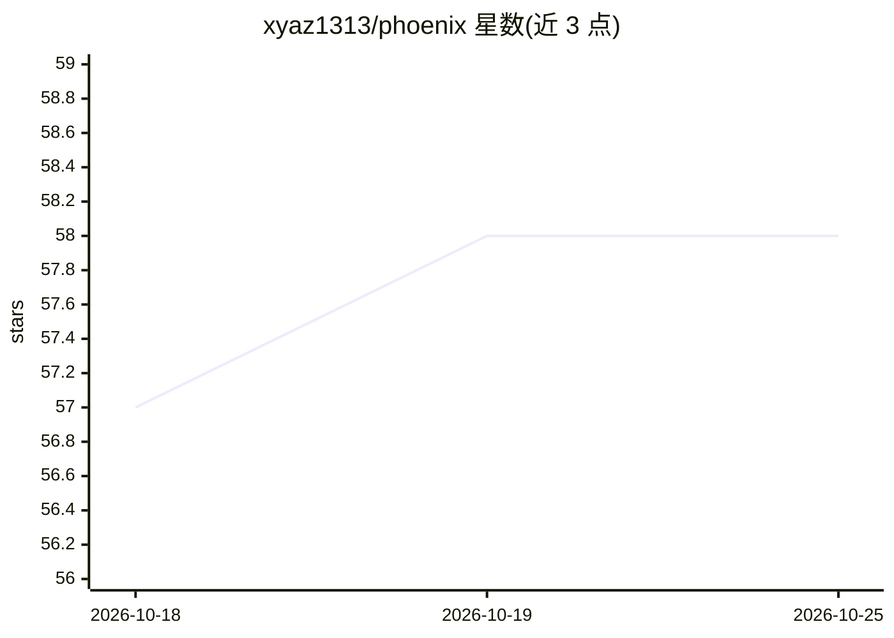

# xyaz1313/phoenix

⭐ 58 · Python · NOASSERTION · 推送 2026-08-11 · [GitHub](https://github.com/xyaz1313/phoenix) · 个人维护 · 中文 README

**Hermes Agent 插件：模型路由分档、风险防线与自愈守护**

面向 Hermes Agent 用户的官方钩子插件，不修改宿主核心代码，卸载即恢复原状。功能含四档加权计分的模型路由（默认只判档不换模型）、三态熔断器与高危操作审批闸、抗体库错误经验查表的自愈系统、/goal 长任务清单强制、幻觉核验、欠费兜底提醒、敏感词隐私路由、分层记忆及 Webhook 审计外发等十余个模块，配 381 个自动化测试。安装从 Releases 下载安装包后经 install.sh/install.ps1 复制并校验，Windows 版提供事务化迁移与失败回滚。采用 CC BY-NC 4.0 许可。

## 筛选速览

| 维度 | 判定 | 备注 |
|---|---|---|
| AI 角色 | `ai-ecosystem` | LLM/agent 周边工具 |
| 许可风险 | `none` | NOASSERTION |
| 部署形态 | `None` |  |
| 模型依赖 | — | README 未给出锁定关系 |
| 硬件要求 | — | 无带数字的原话,不猜 |
| 安装摩擦 | `low` | 无编译、无系统依赖或容器化 |
| 成熟度 | — | 结构信号不足 |

## 能力要点

- 四档加权计分的模型路由分档（闪答/日常/深度/真神），自动换模型默认关闭
- 三态熔断器 + 高危操作审批闸 + 抗体库错误经验查表
- 全程通过 Hermes 官方插件钩子接入，不改宿主核心代码，卸载即恢复
- 381 个自动化测试随功能交付，支持干净环境运行

## 适用场景

- 让 Hermes Agent 按问题难度自动匹配不同成本的模型
- 长任务期间防止代理失控烧钱或执行高危操作
- 积累错误处理经验，避免同一错误反复踩坑
- Hermes 升级后排查插件兼容性问题并自动备份配置

## 场景标签

 · 领域:AI Agent 工具/插件

## 证据(README 行号)

> L9: > 装在 Hermes Agent 上的插件。路由分档、风险防线、自愈系统，全程官方插件钩子接入，不改 Hermes 一行核心代码。
> L11: **支持：Hermes Agent。** 全程通过官方插件系统加载，卸载即恢复原状。
> L81: |Router 路由分档|判断用哪个档位、哪个模型|闪答/日常/深度/真神四档加权计分自动判定|

## 星数曲线

2026-10-18 57 → 2026-10-25 58（+1）

---
*卡片 v1 · prompt 1.4 · 生成 2026-10-24 · 置信度 high · 依据 README sha `055d66fefe0e` · [字段定义](../../DATASET.md)*
