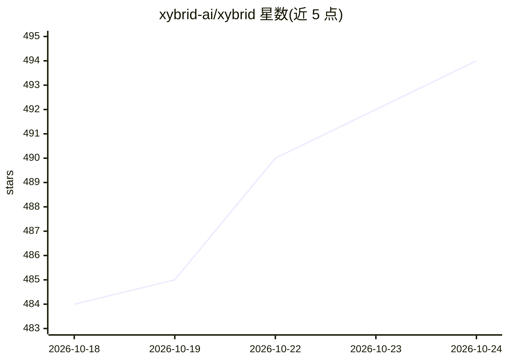

# xybrid-ai/xybrid

⭐ 494 · Rust · Apache-2.0 · 推送 2026-10-24 · [GitHub](https://github.com/xybrid-ai/xybrid) · [官网](https://xybrid.ai) · 组织维护 · 中文 README

**跨平台端侧 AI 推理 SDK：在应用与游戏内本地运行 LLM/ASR/TTS**

面向移动与桌面应用开发者的端侧 AI 工具包，提供 Flutter、Swift、Kotlin、React Native、Unity、Rust、CLI 等接入方式，统一 API 调用 LLM、语音识别、语音合成与视觉模型。推理完全在设备本地运行，首次下载模型后无需网络。底层支持 ONNX Runtime、llama.cpp、whisper.cpp、Candle、CoreML 等后端，另提供多模型串联流水线（MMP）、工具调用、自带模型（BYM，实验性）与云端回退（可选）。iOS 用 Metal/ANE 加速，Android 与 Windows 目前为 CPU。Apache 2.0 许可。

## 筛选速览

| 维度 | 判定 | 备注 |
|---|---|---|
| AI 角色 | `ai-ecosystem` | LLM/agent 周边工具 |
| 许可风险 | `permissive` | Apache-2.0 |
| 部署形态 | `library` | 以包/库形式分发 |
| 模型依赖 | local-ok | 支持本地模型 |
| 硬件要求 | — | 无带数字的原话,不猜 |
| 安装摩擦 | `low` | 无编译、无系统依赖或容器化 |
| 成熟度 | `idea` | |

## 能力要点

- 一套 API 覆盖 iOS/Android/macOS/Linux/Windows 五平台，含 Unity 游戏引擎支持
- 多模型流水线（MMP）：ASR→LLM→TTS 用 YAML 串联一次调用
- 本地模型工具调用，工具以纯数据定义，全部 SDK 可用
- 支持任意 ONNX/GGUF/SafeTensors 模型接入（BYM，实验性）

## 适用场景

- 在移动 App 中离线运行 LLM 对话与语音助手
- Unity 游戏内嵌入本地语音识别与语音合成
- 构建 ASR+LLM+TTS 串联的端侧语音助手流水线
- 替换应用内模型而无需重新发版（模型运行时从注册表解析）

## 场景标签

`语音合成` `语音识别` `推理引擎` · 领域:内容生成

## 证据(README 行号)

> L7:  Run LLMs, ASR, and TTS natively in apps and games.
> L353: - **Many backends, one API** — ONNX Runtime, llama.cpp (GGUF), whisper.cpp,
> L369: ||Xybrid|Ollama|llama.cpp|ONNX Runtime|

## 星数曲线

2026-10-18 484 → 2026-10-24 494（+10）

---
*卡片 v1 · prompt 1.4 · 生成 2026-10-21 · 置信度 high · 依据 README sha `3ec899bdb95e` · [字段定义](../../DATASET.md)*
