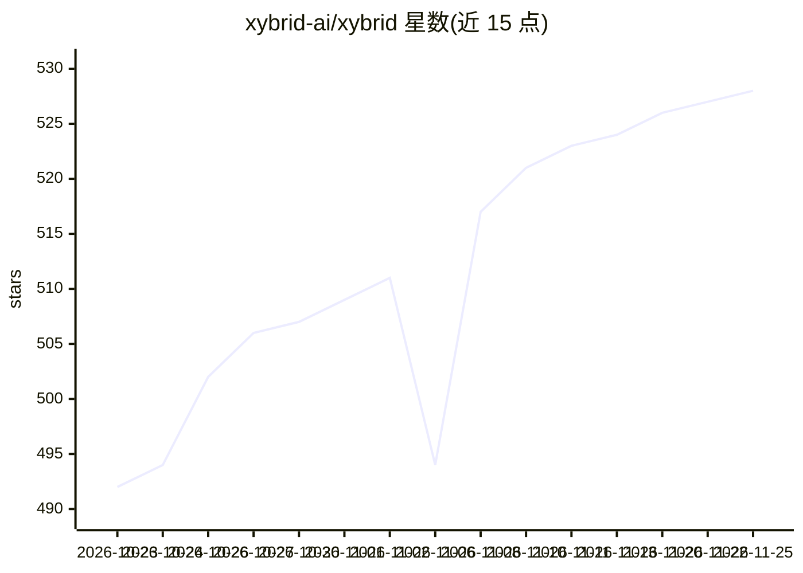

# xybrid-ai/xybrid

⭐ 528 · Rust · Apache-2.0 · 推送 2026-11-23 · [GitHub](https://github.com/xybrid-ai/xybrid) · [官网](https://xybrid.ai) · 组织维护

**面向应用与游戏开发者的跨平台端侧 LLM/ASR/TTS 运行工具包**

提供统一 API 在 iOS、Android、macOS、Linux、Windows 及 Unity 内运行端侧模型，覆盖语音转文本、文本转语音、LLM 与视觉语言模型，支持 Metal/Vulkan 硬件加速与可选云端回退。核心机制包括：YAML 定义的多模型推理管线（ASR→LLM→TTS 串接）、运行时从注册表解析并缓存模型、本地工具调用，以及通过 model_metadata.json 接入任意 ONNX/GGUF/SafeTensors 模型。模型首次下载后可完全离线推理，无需 API key。

## 筛选速览

| 维度 | 判定 | 备注 |
|---|---|---|
| AI 角色 | `ai-ecosystem` | LLM/agent 周边工具 |
| 许可风险 | `permissive` | Apache-2.0 |
| 部署形态 | `library` | 以包/库形式分发 |
| 模型依赖 | local-ok | 支持本地模型 |
| 硬件要求 | — | 无带数字的原话,不猜 |
| 安装摩擦 | `low` | 无编译、无系统依赖或容器化 |
| 成熟度 | — | 结构信号不足 |

## 能力要点

- 一套 API 覆盖 Flutter/Swift/Kotlin/React Native/Unity/Rust/Python/Web/CLI 多端接入
- YAML 多模型推理管线（MMP），可读取每个阶段的中间输出
- 支持 Whisper、Kokoro、LFM2.5、Gemma、Qwen 等注册表模型与 BYM 自带模型
- 端侧推理无需云端与 API key，支持按次选择云端回退

## 适用场景

- 在手游或移动应用中内置离线语音助手
- 在无网络环境下运行本地 LLM 与语音识别
- 用 YAML 管线把 ASR、LLM、TTS 串成一次调用
- 不重新发版即通过注册表更换应用内模型

## 场景标签

`语音 Agent` `语音识别` `语音合成` `推理引擎` · 领域:对话与助手

## 证据(README 行号)

> L7:  Run LLMs, ASR, and TTS natively in apps and games.
> L358: - **Private / offline** — inference runs on-device and keeps working with no
> L361: - **Many backends, one API** — ONNX Runtime, llama.cpp (GGUF), whisper.cpp,

## 星数曲线

2026-10-23 492 → 2026-11-25 528（+36）

---
*卡片 v1 · prompt 1.4 · 生成 2026-11-25 · 置信度 high · 依据 README sha `001c0156d3cb` · [字段定义](../../DATASET.md)*
