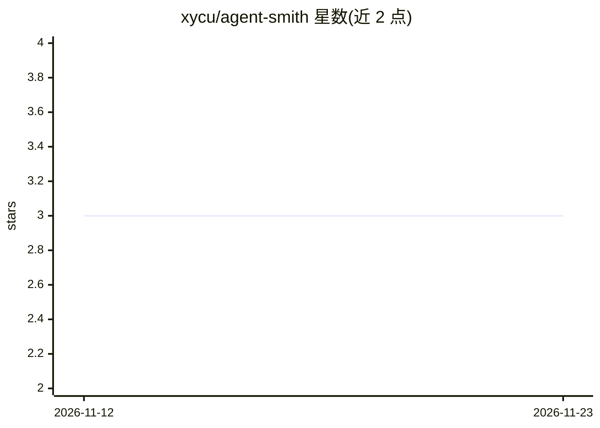

# xycu/agent-smith

⭐ 3 · JavaScript · NOASSERTION · 推送 2026-11-22 · [GitHub](https://github.com/xycu/agent-smith) · 个人维护

**为开发者编排 AI 软件工程工作流的 Claude Code 插件**

一个 Claude Code 插件，通过显式斜杠命令端到端运行 10xDevs 与 OpenSpec 两条 SDLC 流水线：规划、评审、实现、修复、归档，每步在独立子代理中执行并按难度路由模型与 effort。运行在独立 git worktree，每步一次提交，失败自动回滚重试，最终推送分支并开 PR 供人工评审，不自动合并。需要 Claude Code 2.1.292+、Node.js 24+ 与 Git，支持 claude/codex/split 三种 provider 模式，参数经由策略文件调整。

## 筛选速览

| 维度 | 判定 | 备注 |
|---|---|---|
| AI 角色 | `ai-ecosystem` | LLM/agent 周边工具 |
| 许可风险 | `none` | NOASSERTION |
| 部署形态 | `library` | 以包/库形式分发 |
| 模型依赖 | locked-api |  |
| 硬件要求 | — | 无带数字的原话,不猜 |
| 安装摩擦 | `low` | 无编译、无系统依赖或容器化 |
| 成熟度 | — | 结构信号不足 |

## 能力要点

- 每步独立子代理执行，模型按步骤难度自动路由分级
- git worktree 隔离 + 每步提交 + 失败回滚重试，产物为待评审 PR
- --provider-mode 支持 Claude、OpenAI 或拆分分配，逐步报告实际 provider/model/effort
- lean/standard/thorough 三档严格度，run 报告含每步模型、token 与结果

## 适用场景

- 用一条命令驱动从规划到实现评审的整条 AI 开发链路
- 在简单步骤用低成本模型、复杂步骤用高配模型以控制开销
- 让 AI 改动以 PR 形式提交人工评审而非直接合并

## 场景标签

`编码 Agent` · 领域:编码与开发

## 证据(README 行号)

> L7: A Claude Code plugin that runs 10xDevs and OpenSpec workflows end to end through explicit slash commands. Each step 
> L12: - 🧠 **Smart model routing.** Simple steps run on cheaper tiers, hard steps get more power. Automatically.
> L51: Both hosts need Node.js 24+ and Git. Each executing provider needs authenticated access, project trust and discover

## 星数曲线

2026-11-12 3 → 2026-11-23 3（+0）

---
*卡片 v1 · prompt 1.4 · 生成 2026-11-21 · 置信度 mid · 依据 README sha `8e0b441bf912` · [字段定义](../../DATASET.md)*
