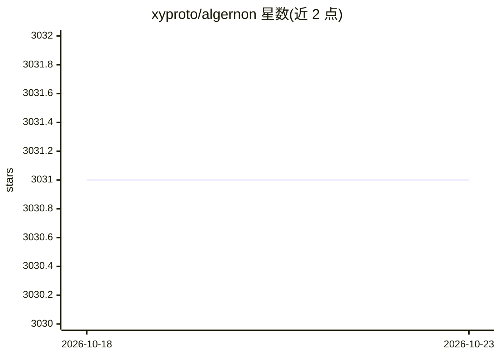

# xyproto/algernon

⭐ 3,031 · JavaScript · BSD-3-Clause · 推送 2026-10-22 · [GitHub](https://github.com/xyproto/algernon) · [官网](https://algernon.roboticoverlords.org) · 个人维护

**单文件纯 Go Web 服务器，内置 Lua/Markdown/Ollama 等多种支持**

用 Go 编写的自包含 Web 服务器，编译为单一可执行文件，支持 HTTP/2、HTTP/3(QUIC)、Lua/Teal 脚本作为请求处理器、Markdown/Pongo2/Amber/Sass/GCSS/JSX/TypeScript 渲染，以及 BoltDB/Redis/PostgreSQL/MySQL 等数据库后端。AI 部分为内置 Ollama 接入：通过 index.prompt 文件指定 Ollama 模型与提示词生成内容。面向需要在无外部依赖环境下快速搭建网站或 Web 应用的开发者；自动刷新功能目前仅限 Linux/macOS，Redis 缺省时回退到内置 Bolt 数据库。

## 筛选速览

| 维度 | 判定 | 备注 |
|---|---|---|
| AI 角色 | `ai-enhanced` | 去掉 AI 部分产品仍成立 |
| 许可风险 | `permissive` | BSD-3-Clause |
| 部署形态 | `desktop` | 安装包/桌面程序 |
| 模型依赖 | local-ok | 支持本地模型 |
| 硬件要求 | — | 无带数字的原话,不猜 |
| 安装摩擦 | `low` | 无编译、无系统依赖或容器化 |
| 成熟度 | — | 结构信号不足 |

## 能力要点

- 单一自包含可执行文件，纯 Go 编写，无外部依赖
- 内置 Lua/Teal 脚本处理 HTTP 请求，可加载插件（JSON-RPC）
- index.prompt 文件指定 Ollama 模型与提示词生成 LLM 内容
- npm-less React 19：内置 JSX/TSX 到 JavaScript 的转译（esbuild）

## 适用场景

- 用 Markdown/Amber/Lua 快速搭建和预览网站
- 通过 index.prompt 结合 Ollama 生成 LLM 内容
- 在无数据库主机的环境下用内置 Bolt 运行 Web 应用

## 场景标签

 · 领域:Web 服务器/开发工具

## 证据(README 行号)

> L9: Web server with built-in support for HTTP/2, HTTP/3 (QUIC), Lua, Teal, Markdown, Pongo2, HyperApp, Amber, Sass(SCSS)
> L73:  * index.prompt is a content-type, an Ollama model, a blank line and a prompt, for generating content with LLMs.

## 星数曲线

2026-10-18 3,031 → 2026-10-23 3,031（+0）

---
*卡片 v1 · prompt 1.4 · 生成 2026-10-20 · 置信度 high · 依据 README sha `621a096d2b56` · [字段定义](../../DATASET.md)*
