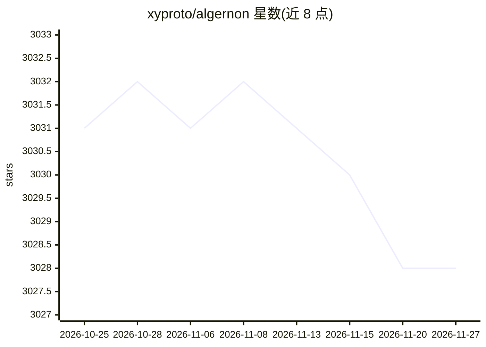

# xyproto/algernon

⭐ 3,028 · JavaScript · BSD-3-Clause · 推送 2026-11-26 · [GitHub](https://github.com/xyproto/algernon) · [官网](https://algernon.roboticoverlords.org) · 个人维护

**给开发者的自包含单执行文件 Web 服务器，内置 Lua 与多种渲染/数据库支持**

用 Go 编写的单二进制 Web 服务器，无需外部依赖。内置 HTTP/2、HTTP/3(QUIC)、Lua/Teal 脚本处理、Markdown/Pongo2/Amber/Sass/GCSS/JSX/TypeScript 渲染、npm-less React 19 打包（esbuild），数据库后端支持 BoltDB（内置）、Redis/Valkey、PostgreSQL、SQLite、MariaDB/MySQL、MSSQL。支持用户与权限管理、速率限制、优雅关停、插件（JSON-RPC）、自动刷新预览、交互式 REPL，以及通过 index.prompt 文件调用 Ollama 生成内容。默认路径基本无需配置。

## 筛选速览

| 维度 | 判定 | 备注 |
|---|---|---|
| AI 角色 | `ai-enhanced` | 去掉 AI 部分产品仍成立 |
| 许可风险 | `permissive` | BSD-3-Clause |
| 部署形态 | `desktop` | 安装包/桌面程序 |
| 模型依赖 | local-ok | 支持本地模型 |
| 硬件要求 | — | 无带数字的原话,不猜 |
| 安装摩擦 | `low` | 无编译、无系统依赖或容器化 |
| 成熟度 | — | 结构信号不足 |

## 能力要点

- 单文件自包含可执行程序，无外部依赖，纯 Go 实现
- 内置多种渲染管线：Markdown/Pongo2/Amber/Sass/GCSS/JSX/TSX/Teal/Lua
- 多种数据库后端：内置 BoltDB、Redis、PostgreSQL、SQLite、MariaDB/MySQL、MSSQL
- 通过 index.prompt 文件以指定 Ollama 模型生成页面内容

## 适用场景

- 零配置快速起一个小型网站或原型服务
- 用 Lua 脚本写 HTTP 处理器做轻量后端
- 本地预览 Markdown 文件与静态页面
- 不依赖 npm 直接服务 React/TSX 页面

## 场景标签

 · 领域:Web 服务器/开发工具

## 证据(README 行号)

> L9: Web server with built-in support for HTTP/2, HTTP/3 (QUIC), Lua, Teal, Markdown, Pongo2, HyperApp, Amber, Sass(SCSS)
> L73:  * index.prompt is a content-type, an Ollama model, a blank line and a prompt, for generating content with LLMs.

## 星数曲线

2026-10-25 3,031 → 2026-11-27 3,028（-3）

---
*卡片 v1 · prompt 1.4 · 生成 2026-11-27 · 置信度 high · 依据 README sha `475f46a80939` · [字段定义](../../DATASET.md)*
