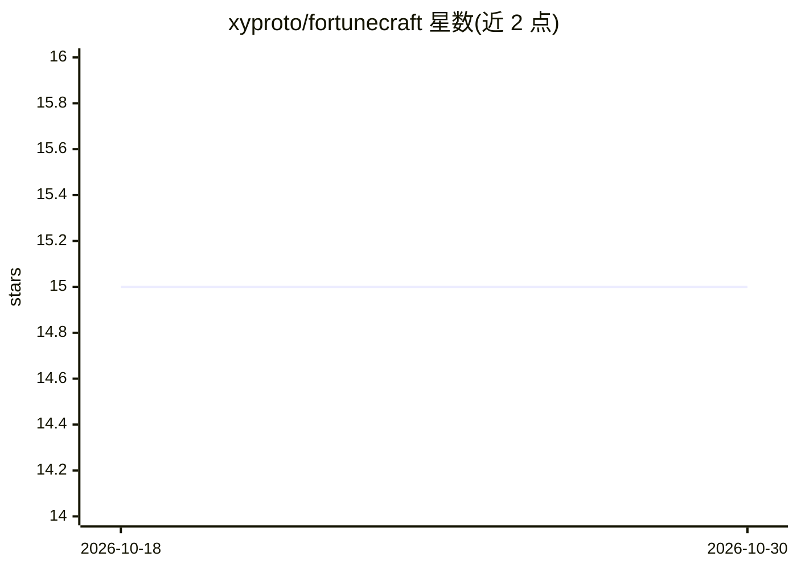

# xyproto/fortunecraft

⭐ 15 · Go · Apache-2.0 · 推送 2026-06-13 · [GitHub](https://github.com/xyproto/fortunecraft) · 个人维护

**调用 Ollama 生成运势签语的命令行工具**

Go 编写的终端小工具，通过本地运行的 Ollama 服务和用户指定的文本生成模型输出 fortune 风格签语，支持默认模型以外的模型选择（经 llm-manager 配置）。要求 Ollama 服务已启动且模型可在当前 CPU/内存下运行，GPU 可选，可通过 OLLAMA_HOST 指定服务地址。提供多个风格旗标（如 absurd、boomer）。项目目标之一是成为较早依赖 Ollama 与 ollama-environment 的 Arch Linux 包。

## 筛选速览

| 维度 | 判定 | 备注 |
|---|---|---|
| AI 角色 | `ai-native` | 本体是模型或模型工具 |
| 许可风险 | `permissive` | Apache-2.0 |
| 部署形态 | `library` | 以包/库形式分发 |
| 模型依赖 | local-ok | 支持本地模型 |
| 硬件要求 | — | 无带数字的原话,不猜 |
| 安装摩擦 | `low` | 无编译、无系统依赖或容器化 |
| 成熟度 | — | 结构信号不足 |

## 能力要点

- 经 Ollama 服务调用用户指定的文本生成模型产出签语
- 风格旗标控制输出（如 --absurd、--boomer）
- OLLAMA_HOST 可自定义服务地址
- 可经 llm-manager 选择非默认模型

## 适用场景

- 在终端获取由本地 LLM 生成的签语
- 为依赖 Ollama 的打包提供参考实践

## 场景标签

`AI 写作` · 领域:内容生成

## 证据(README 行号)

> L3: Output fortunes by using Ollama and a user-defined text generation model.
> L15: Requires an Ollama server to be up and running, and the selected model to be able to run / be evaluated, in terms o

## 星数曲线

2026-10-18 15 → 2026-10-30 15（+0）

---
*卡片 v1 · prompt 1.4 · 生成 2026-10-30 · 置信度 high · 依据 README sha `da8d639a68ba` · [字段定义](../../DATASET.md)*
