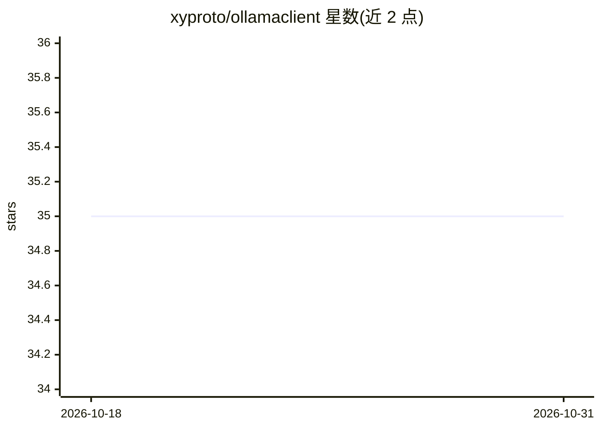

# xyproto/ollamaclient

⭐ 35 · Go · Apache-2.0 · 推送 2026-05-20 · [GitHub](https://github.com/xyproto/ollamaclient) · 个人维护

**Go 语言的 Ollama/LLM 客户端库及示例工具**

提供 Go 包封装 Ollama 的生成、图像描述（llava 模型）与 embeddings 接口，通过 OLLAMA_HOST 等环境变量配置连接与模型，默认模型由 llm-manager 决定。附带 summarize 命令行工具，可用自定义提示词汇总多个文件并输出到文件。需先本地安装并运行 Ollama 服务，测试依赖本地 Ollama 服务器并会下载模型。Apache 2 许可，版本 2.8.1。

## 筛选速览

| 维度 | 判定 | 备注 |
|---|---|---|
| AI 角色 | `ai-ecosystem` | LLM/agent 周边工具 |
| 许可风险 | `permissive` | Apache-2.0 |
| 部署形态 | `library` | 以包/库形式分发 |
| 模型依赖 | local-ok | 支持本地模型 |
| 硬件要求 | — | 无带数字的原话,不猜 |
| 安装摩擦 | `low` | 无编译、无系统依赖或容器化 |
| 成熟度 | — | 结构信号不足 |

## 能力要点

- Go 包封装 Ollama 生成/embeddings/图像描述接口
- summarize 工具支持自定义提示词、输出文件与换行宽度
- 支持 OLLAMA_HOST/OLLAMA_MODEL/OLLAMA_VERBOSE 环境变量配置

## 适用场景

- 在 Go 程序中调用本地 Ollama 模型生成文本或 embeddings
- 用命令行快速汇总 README 与源码文件
- 基于 llava 模型生成图像描述

## 场景标签

 · 领域:LLM 基础设施/客户端库

## 证据(README 行号)

> L5: A Go package for using Ollama and large language models (LLMs).
> L27: Make sure to install and run Ollama locally first, or set `OLLAMA_HOST` to a valid host.

## 星数曲线

2026-10-18 35 → 2026-10-31 35（+0）

---
*卡片 v1 · prompt 1.4 · 生成 2026-10-25 · 置信度 high · 依据 README sha `09dee4bab673` · [字段定义](../../DATASET.md)*
