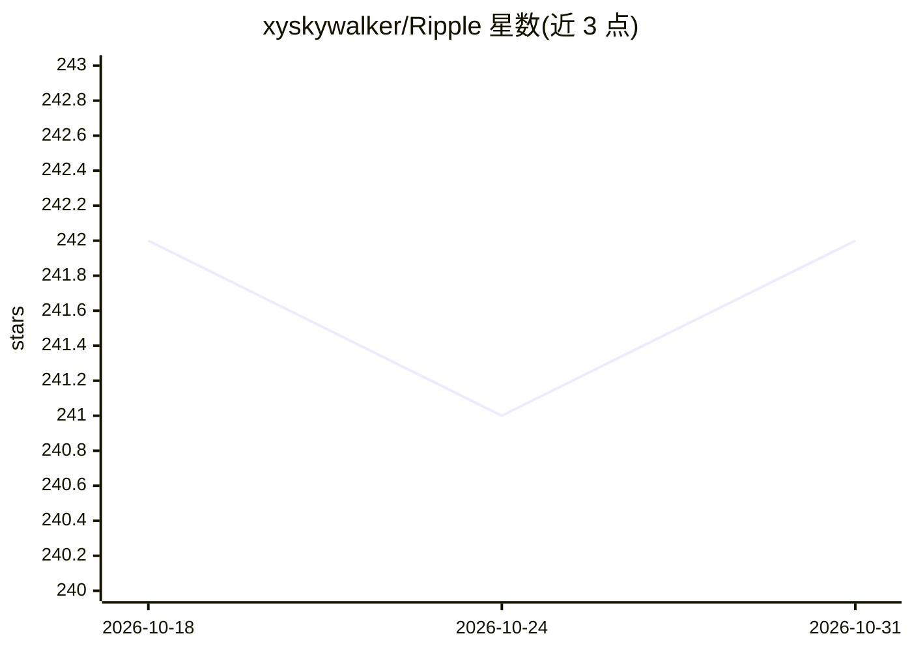

# xyskywalker/Ripple

⭐ 242 · Python · AGPL-3.0 · 推送 2026-04-27 · [GitHub](https://github.com/xyskywalker/Ripple) · 个人维护 · 中文 README

**基于 CAS 理论的人类社会行为预测引擎，产出传播/PMF 预测**

以复杂自适应系统（CAS）理论为底座的多智能体社会行为预测引擎：用『星海合议』四体架构（全视者/星/海/合议庭）+ 5-Phase Wave 循环模拟信号在智能体网络中的传播，已实现社交媒体传播预测（支持小红书/抖音/微博等 7 平台）与 PMF 验证两个场景，输出含置信度的预测、动力学诊断与优化建议。面向内容创作、产品市场分析等应用场景。群体模拟替代逐人模拟以压缩 LLM 调用量，决策交由 LLM（Anthropic/OpenAI 兼容协议/AWS Bedrock/火山引擎等）。提供 Docker 服务（HTTP+SSE）、一键脚本与 ripple-cli。

## 筛选速览

| 维度 | 判定 | 备注 |
|---|---|---|
| AI 角色 | `ai-native` | 本体是模型或模型工具 |
| 许可风险 | `viral` | AGPL-3.0 |
| 部署形态 | `self-host` | docker 或自建部署 |
| 模型依赖 | — | README 未给出锁定关系 |
| 硬件要求 | — | 无带数字的原话,不猜 |
| 安装摩擦 | `low` | 无编译、无系统依赖或容器化 |
| 成熟度 | — | 结构信号不足 |

## 能力要点

- 四体智能体架构（全视者/星/海/合议庭）+ 5-Phase Wave 执行循环
- 合议庭多专家结构化辩论与反乐观偏误五层防线
- 群体模拟将 LLM 调用压缩约 3 个数量级（相对 OASIS）
- Skill 包以纯自然语言画像零代码扩展领域/平台/渠道

## 适用场景

- 发布前预测一条内容在小红书/抖音等平台的传播表现
- 输入产品方案模拟消费者群体反应，获得 PMF 评分与风险诊断
- 为新的平台或行业垂类注入领域画像做行为模拟

## 场景标签

`多智能体` · 领域:Agent 开发

## 证据(README 行号)

> L57: - **📱 社交媒体内容传播预测**：输入一条计划发布的内容，系统通过多智能体模拟，输出含置信度的传播预测、系统动力学诊断和可操作的优化建议
> L58: - **🎯 PMF（产品市场契合度）验证**：输入产品方案与目标市场，系统模拟消费者群体的真实反应，输出多维度 PMF 评分、风险诊断和改进策略

## 星数曲线

2026-10-18 242 → 2026-10-31 242（+0）

---
*卡片 v1 · prompt 1.4 · 生成 2026-10-22 · 置信度 high · 依据 README sha `28761e349ddb` · [字段定义](../../DATASET.md)*
