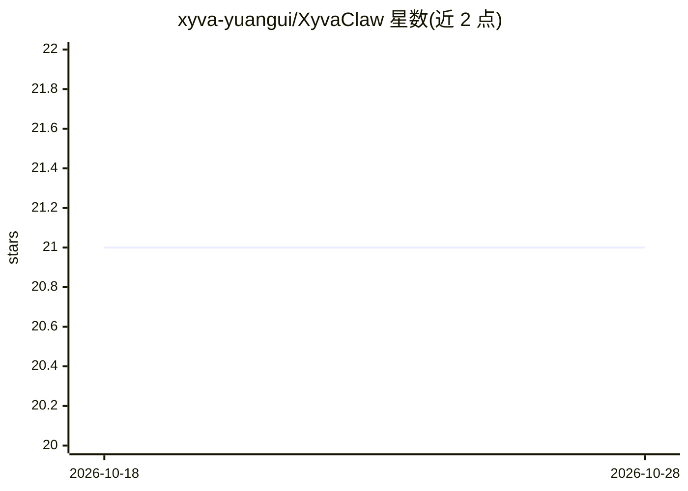

# xyva-yuangui/XyvaClaw

⭐ 21 · Python · MIT · 推送 2026-08-07 · [GitHub](https://github.com/xyva-yuangui/XyvaClaw) · [官网](https://www.xyvaclaw.com) · 个人维护 · 中文 README

**自部署 AI 助手平台：五阶段认知管道与 42+ 技能**

基于 OpenClaw 运行时构建的 AI 助手平台，面向终端用户提供聊天与任务执行。每条消息经五阶段认知管道处理（意图分析、任务分解、推理链、质量门控、延迟监控），配备四层记忆系统（WAL 先写后回、128K 上下文压缩）与自我迭代引擎。模型侧支持 DeepSeek/Qwen/Kimi 三级 fallback 及任意 OpenAI 兼容 API。内置 42+ 技能（浏览器自动化、文档处理、邮件、量化、小红书等）与飞书深度集成（112 个 TypeScript 源文件）。通过 git clone 加安装脚本一键部署，自动安装 Node.js、Python、ffmpeg 等依赖，浏览器向导完成配置。V15 认知引擎默认关闭。

## 筛选速览

| 维度 | 判定 | 备注 |
|---|---|---|
| AI 角色 | `ai-native` | 本体是模型或模型工具 |
| 许可风险 | `permissive` | MIT |
| 部署形态 | `None` |  |
| 模型依赖 | locked-api |  |
| 硬件要求 | — | 无带数字的原话,不猜 |
| 安装摩擦 | `medium` | 含编译或系统依赖之一 |
| 成熟度 | — | 结构信号不足 |

## 能力要点

- 五阶段认知管道：意图分析→任务分解→推理链→质量门控→延迟监控
- 三级模型容灾（DeepSeek→Qwen→Kimi）与自定义 OpenAI 兼容 Provider
- 四层记忆系统：WAL 协议、Working Buffer、128K 上下文压缩（宣称 35.7% token 节省）
- 飞书深度集成（112 个 TypeScript 源文件）与 42+ 内置技能

## 适用场景

- 通过飞书或 WebChat 与自部署 AI 助手对话完成日常任务
- 自动化处理文档、邮件、网页抓取、内容创作等工作流
- 在国内模型服务（DeepSeek/百炼）上搭建个人可定制的助手

## 场景标签

`AI 助手` `聊天机器人` `浏览器自动化` `网页抓取` · 领域:效率与自动化

## 证据(README 行号)

> L84: xyvaClaw 是基于 OpenClaw 运行时**深度增强**的 AI 助手平台。它不只是聊天机器人——通过 **V5 五阶段认知管道**，它能**理解意图、分解任务、结构化推理、质量自检**，再给出回答。
> L258: │  用户     │────→│  飞书/WebChat │────→│  OpenClaw Gateway  │
> L70:  - DeepSeek（推荐，注册即送免费额度）

## 星数曲线

2026-10-18 21 → 2026-10-28 21（+0）

---
*卡片 v1 · prompt 1.4 · 生成 2026-10-28 · 置信度 high · 依据 README sha `7f506a442d65` · [字段定义](../../DATASET.md)*
