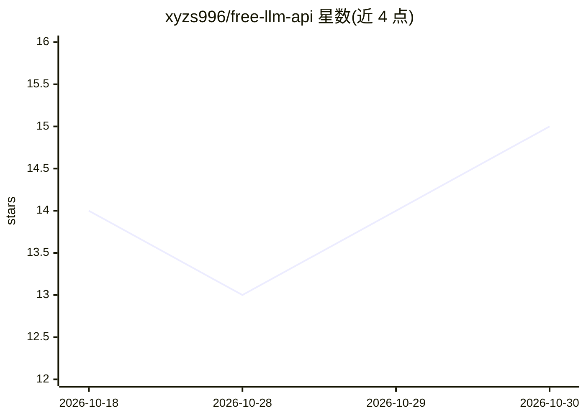

# xyzs996/free-llm-api

⭐ 15 · JavaScript · MIT · 推送 2026-08-23 · [GitHub](https://github.com/xyzs996/free-llm-api) · [官网](https://xyzs996.github.io/free-llm-api/) · 个人维护 · 中文 README

**免费 LLM API 提供商目录：核验免费额度与端点信息**

维护 26 个 LLM API 提供商的免费层状态数据集：每条含模型、公布的请求限额、是否需信用卡、OpenAI 兼容性与 base URL，所有条目链接官方来源并带核验日期。区分 13 个永久免费层与试用额度/计量服务/聚合器等其他访问方式。另提供 npx 命令生成 Claude Code/Codex CLI/Cline 等客户端配置、浏览器端 API key 检查器，以及 providers.json/CSV 供程序读取；不分发任何 key。

## 筛选速览

| 维度 | 判定 | 备注 |
|---|---|---|
| AI 角色 | `ai-knowledge` | 知识聚合/清单类 |
| 许可风险 | `permissive` | MIT |
| 部署形态 | `library` | 以包/库形式分发 |
| 模型依赖 | — | README 未给出锁定关系 |
| 硬件要求 | — | 无带数字的原话,不猜 |
| 安装摩擦 | `low` | 无编译、无系统依赖或容器化 |
| 成熟度 | — | 结构信号不足 |

## 能力要点

- 26 个提供商条目，每条限额链接官方来源并带核验日期
- 区分永久免费层、试用额度、计量访问与聚合器
- npx free-llm-api setup 生成编码代理客户端配置
- providers.json/CSV 可被程序直接拉取（CORS 开放）

## 适用场景

- 为编码代理挑选免信用卡的 OpenAI 兼容 API
- 在浏览器里检查已有 key 是否可用
- 把免费层目录数据拉进自己的选型脚本

## 场景标签

`精选清单` · 领域:学习与行业

## 证据(README 行号)

> L10: Permanent free tiers, no-card options, direct API key links, models, and verified limits — every claim points to an
> L65: |Provider|Models|Published limits|Card|OpenAI compatible|Get API key|
> L152: - Every limit and lifecycle claim links to an official source and carries a review date.

## 星数曲线

2026-10-18 14 → 2026-10-30 15（+1）

---
*卡片 v1 · prompt 1.4 · 生成 2026-10-30 · 置信度 high · 依据 README sha `4729e9d4e614` · [字段定义](../../DATASET.md)*
