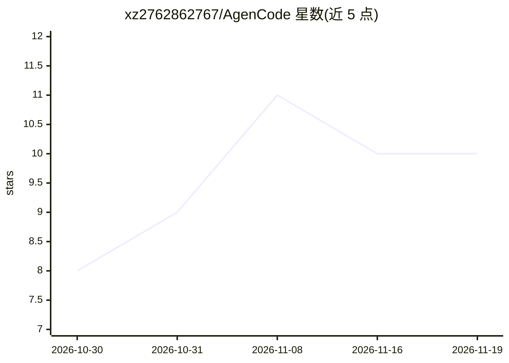

# xz2762862767/AgenCode

⭐ 10 · Java · MIT · 推送 2026-11-10 · [GitHub](https://github.com/xz2762862767/AgenCode) · 个人维护 · 中文 README

**Android 上的 AI 智能体：接 OpenAI 兼容接口并执行本地任务**

一个运行在 Android 手机上的 AI 助手应用，将对话与本地执行环境结合：接入任意 OpenAI 兼容接口，模型可通过 Function Calling 调用内置 Linux shell（Alpine + proot）、APK 反编译/回编译/签名、构建打包、联网抓取等本地能力，并支持技能包导入与 MCP 外部工具接入。提供 Releases 安装包，也可自行用 Gradle 构建。面向需要在手机端直接执行任务的用户，已知限制包括部分机型不支持 proot 及仅支持 OpenAI 兼容协议。

## 筛选速览

| 维度 | 判定 | 备注 |
|---|---|---|
| AI 角色 | `ai-native` | 本体是模型或模型工具 |
| 许可风险 | `permissive` | MIT |
| 部署形态 | `None` |  |
| 模型依赖 | — | README 未给出锁定关系 |
| 硬件要求 | — | 无带数字的原话,不猜 |
| 安装摩擦 | `medium` | 含编译或系统依赖之一 |
| 成熟度 | — | 结构信号不足 |

## 能力要点

- 模型可主动调用本地工具：Linux shell 执行命令、APK 反编译/回编译/签名
- 内置 Alpine + proot Linux 环境，一键安装
- 支持技能包（zip 导入）与 MCP 服务器工具扩展
- SSE 流式输出、多会话本地持久化

## 适用场景

- 在手机上让模型执行 shell 命令、跑脚本
- 对 APK 进行反编译、修改资源与清单后回编译签名
- 接入 MCP 服务器扩展可用工具集

## 场景标签

`AI 助手` `编码 Agent` · 领域:编码与开发

## 证据(README 行号)

> L8: 一个跑在 Android 手机上的 AI 助手，把「能聊天」和「能干活」放在同一个 App 里：
> L36: 模型可以主动调用本地能力，不是只给建议：
> L40: |Shell|在 App 内置 Linux 里执行命令，读写文件，跑脚本|

## 星数曲线

2026-10-30 8 → 2026-11-19 10（+2）

---
*卡片 v1 · prompt 1.4 · 生成 2026-11-19 · 置信度 high · 依据 README sha `febdbe76dd9e` · [字段定义](../../DATASET.md)*
