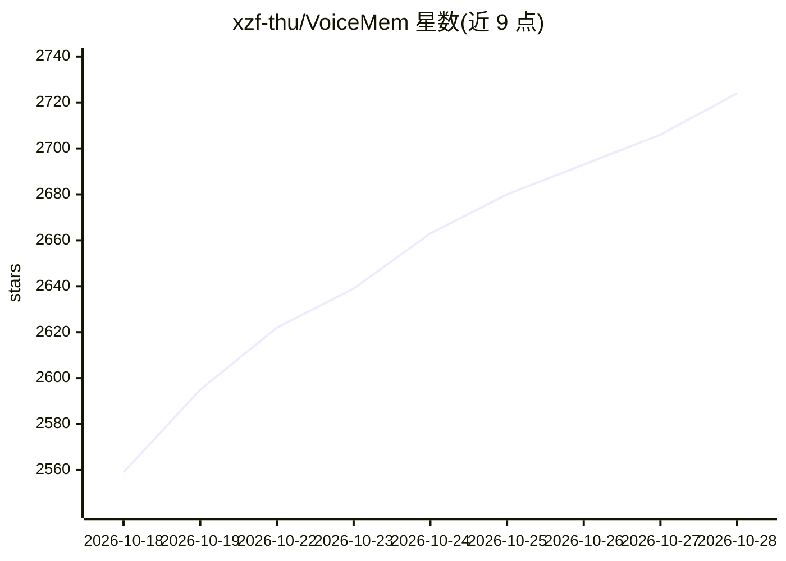

# xzf-thu/VoiceMem

⭐ 2,741 · Python · Apache-2.0 · 推送 2026-09-14 · [GitHub](https://github.com/xzf-thu/VoiceMem) · 组织维护 · 中文 README

**面向实时语音智能体的长期记忆系统（流式双脑架构）**

为实时语音智能体提供长期记忆基础设施：左脑以 Schema/实体组织事实记忆，右脑管理人格、情绪与关系节点，全流程流式处理（音频分段、转写、记忆提取在用户说话时完成），查询时先路由再排序仅注入 Top-K 记忆。可离线作为记忆引擎运行，也可接入自有语音模型；记忆检索本地运行，写入时的事实抽取使用 OpenAI API。附带交互式 Web 演示、微调代码、ChatMem-400K 数据集与开源模型系列（Qwen2.5-Omni/Qwen3-Omni/Step-Audio2-Mini），评测流程可复现。Python 3.10+，git clone 安装，Apache 2.0。

## 筛选速览

| 维度 | 判定 | 备注 |
|---|---|---|
| AI 角色 | `ai-ecosystem` | LLM/agent 周边工具 |
| 许可风险 | `permissive` | Apache-2.0 |
| 部署形态 | `library` | 以包/库形式分发 |
| 模型依赖 | — | README 未给出锁定关系 |
| 硬件要求 | — | 无带数字的原话,不猜 |
| 安装摩擦 | `low` | 无编译、无系统依赖或容器化 |
| 成熟度 | — | 结构信号不足 |

## 能力要点

- 左脑事实记忆（Schema/实体）+ 右脑人格/情绪记忆的双脑架构
- 全流程流式：边说边转写、提取并写入记忆图，查询注入 Top-K
- 可接入自有语音模型，记忆检索本地运行，组件与记忆引擎均可更换
- 提供微调代码、ChatMem-400K 数据集与 ChatMem-Bench 评测流程

## 适用场景

- 给我的语音助手加上跨会话的长期记忆
- 在语音轮次内部做低延迟记忆预取与检索
- 训练能读取结构化记忆的语音模型 adapter

## 场景标签

`Agent 记忆` `微调` `模型评测` · 领域:Agent 开发

## 证据(README 行号)

> L137: **VoiceMem** 是一个面向实时语音智能体的记忆系统。
> L176: ## 🔌 使用 VoiceMem 定制你的语音智能体
> L386: **VoiceMem** is a memory system built for real-time voice agents.

## 星数曲线

2026-10-18 2,559 → 2026-10-28 2,724（+165）

---
*卡片 v1 · prompt 1.4 · 生成 2026-10-21 · 置信度 mid · 依据 README sha `df5bfa562220` · [字段定义](../../DATASET.md)*
