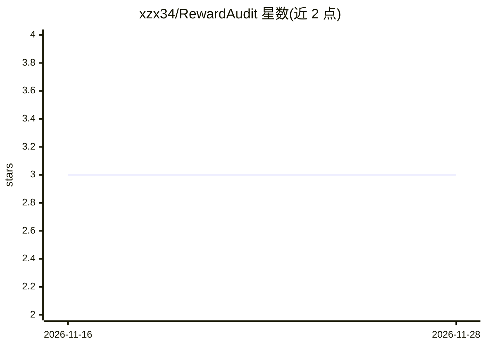

# xzx34/RewardAudit

⭐ 3 · Python · Apache-2.0 · 推送 2026-11-12 · [GitHub](https://github.com/xzx34/RewardAudit) · 个人维护

**为 LLM 评测与 RLVR 中的规则类校验器提供自动化测试的工具**

针对给模型输出打分的 checker（规则类 reward 函数）做自动化审计：依据数据集的 ground truth 构造已知正确得分的探针输出，送入被测 checker 打分，按 79 个探针、8 个家族、22 类缺陷分组报告问题，并对高危缺陷做多次确认与最小化复现。只需提供 checker 与带答案的数据集，无需 API 与 GPU，单次审计耗时秒级；支持 verl/TRL 签名匹配、verifiers 环境、CI 退出码与阈值配置。仅限规则类 checker，LLM judge 与 reward model 不在范围内。

## 筛选速览

| 维度 | 判定 | 备注 |
|---|---|---|
| AI 角色 | `ai-ecosystem` | LLM/agent 周边工具 |
| 许可风险 | `permissive` | Apache-2.0 |
| 部署形态 | `library` | 以包/库形式分发 |
| 模型依赖 | — | README 未给出锁定关系 |
| 硬件要求 | — | 无带数字的原话,不猜 |
| 安装摩擦 | `low` | 无编译、无系统依赖或容器化 |
| 成熟度 | — | 结构信号不足 |

## 能力要点

- 79 个探针、8 个家族、22 类缺陷的构造性测试
- checker 在带时间与内存限制的独立进程中运行，崩溃/挂起记为发现
- 支持 verl、TRL 签名按名匹配，免改动直接审计；数据集支持 JSONL/JSON/CSV/Parquet/Hugging Face
- 提供 CI 退出码、自定义阈值与版本对比命令

## 适用场景

- RLVR 训练前审计 reward 函数是否存在漏洞
- 评测框架上线前检查答案匹配逻辑
- 在 CI 中按阈值拦截有高危缺陷的 checker 版本

## 场景标签

`模型评测` `强化学习` · 领域:评测与运维

## 证据(README 行号)

> L17: Many benchmarks, and most reinforcement learning with verifiable rewards, rely on a **checker**: a function that
> L23: RewardAudit tests a checker the way you would test a function: it builds outputs whose correct score is known in
> L24: advance, has the checker score them, and finds the ones it scores wrongly. All it needs is the checker and a datase

## 星数曲线

2026-11-16 3 → 2026-11-28 3（+0）

---
*卡片 v1 · prompt 1.4 · 生成 2026-11-21 · 置信度 high · 依据 README sha `335b75ee3417` · [字段定义](../../DATASET.md)*
