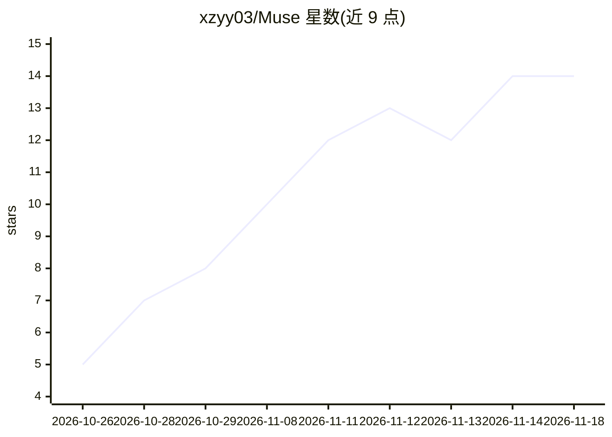

# xzyy03/Muse

⭐ 14 · Kotlin · GPL-3.0 · 推送 2026-11-17 · [GitHub](https://github.com/xzyy03/Muse) · [官网](https://xzyy03.github.io/Muse/) · 个人维护 · 中文 README

**Android 上的 AI Coding Agent 应用（miuix 风格 UI 二改版）**

基于 jieapi/AiCode 的 UI 二改版（GPL-3.0），品牌与包名改为 Muse，界面改为 miuix/HyperOS 观感。本体为运行于 Android 的通用 AI Coding Agent：基于 Termux/PRoot 的本地 Linux 容器中由 AI Agent 读写文件、执行 Shell、运行构建，亦可切换远程 SSH 或 Shizuku 作为执行后端。不内置模型，兼容 OpenAI/Anthropic/Gemini 协议与自定义供应商，支持 MCP、子代理并行、检查点回滚、Git 可视化管理与 SFTP/FTP 同步。通过 GitHub Releases 提供 APK（Android 8.0+）。

## 筛选速览

| 维度 | 判定 | 备注 |
|---|---|---|
| AI 角色 | `ai-native` | 本体是模型或模型工具 |
| 许可风险 | `viral` | GPL-3.0 |
| 部署形态 | `None` |  |
| 模型依赖 | — | README 未给出锁定关系 |
| 硬件要求 | — | 无带数字的原话,不猜 |
| 安装摩擦 | `low` | 无编译、无系统依赖或容器化 |
| 成熟度 | — | 结构信号不足 |

## 能力要点

- AI Agent 内置文件读写、Shell 执行、终端、搜索、图片识别等工具，长对话自动压缩上下文
- 基于 Termux/PRoot 的本地 Linux 容器，支持远程 SSH 与 Shizuku 执行后端
- 模型无关：兼容 OpenAI / Anthropic / Gemini 协议与自定义供应商，多 Key 轮换
- 支持本地（stdio）与远程（HTTP）MCP 服务器、子代理并行与检查点回滚

## 适用场景

- 在手机本地完成写代码、调试与构建
- 把手机作为远程 SSH 项目的移动工作站
- 通过对话让 AI 在内置浏览器中完成网页操作
- 在 Android 上可视化管理 Git 提交与分支

## 场景标签

`编码 Agent` `浏览器自动化` · 领域:效率与自动化

## 证据(README 行号)

> L35: Muse 是运行在 Android 上的通用 AI Coding Agent，把一套完整的 Linux 开发环境装进手机：内置终端，AI Agent 能读写文件、执行 Shell 命令、运行构建工具，写代码、调试到构建都在手机本地
> L57: - **AI Agent** — 内置文件读写与编辑、Shell 执行、后台终端、代码与网页搜索、图片识别、待办清单等工具；流式输出并实时渲染 Markdown，长对话自动压缩上下文

## 星数曲线

2026-10-26 5 → 2026-11-18 14（+9）

---
*卡片 v1 · prompt 1.4 · 生成 2026-11-18 · 置信度 high · 依据 README sha `f1f7581558dc` · [字段定义](../../DATASET.md)*
