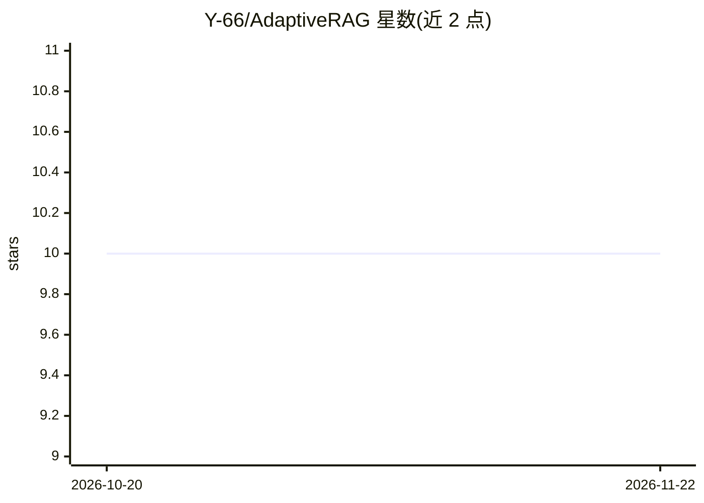

# Y-66/AdaptiveRAG

⭐ 10 · Python · 推送 2026-02-15 · [GitHub](https://github.com/Y-66/AdaptiveRAG) · 个人维护

**面向开发者的自适应 RAG 查询路由与多智能体问答系统**

基于 LangGraph 构建的 RAG 系统：全局路由器按问题意图分发到三类专用 agent——Self-RAG（检索-评级-重写-校验循环，过滤无关文档并检测幻觉）、SQL Agent（自然语言转 SQL，含语法错误自动修复）、Web Search Agent（通过 MCP 连接外部搜索引擎）。技术栈含 LangChain、ChromaDB、SQLite、OpenAI。支持处理非结构化文档（PDF/年报）与结构化数据库。安装需 Python 3.12 Conda 环境，配置 OpenAI 与 Tavily API key，另提供 Docker 运行方式。

## 筛选速览

| 维度 | 判定 | 备注 |
|---|---|---|
| AI 角色 | `ai-native` | 本体是模型或模型工具 |
| 许可风险 | `none` | — |
| 部署形态 | `self-host` | docker 或自建部署 |
| 模型依赖 | — | README 未给出锁定关系 |
| 硬件要求 | — | 无带数字的原话,不猜 |
| 安装摩擦 | `low` | 无编译、无系统依赖或容器化 |
| 成熟度 | — | 结构信号不足 |

## 能力要点

- 按意图自适应路由到 Financial RAG / SQL / Web Search 三类 agent
- Self-RAG 检索-评级-重写-校验循环与幻觉检测
- SQL Agent 自然语言转 SQL 并自动修复语法错误
- 多步推理可将复杂问题拆解为子查询

## 适用场景

- 基于年报等非结构化文档的财务问答
- 对结构化数据库进行自然语言查询
- 本地数据不足时检索实时网络信息

## 场景标签

`多智能体` `RAG` `数据分析` · 领域:Agent 开发

## 证据(README 行号)

> L3: An agentic adaptive RAG system designed for **intelligent query routing** and **multi-agent collaboration**.
> L27: AdaptiveRAG is a sophisticated system that leverages "Adaptive Routing + Multi-Agent Collaboration" to answer compl
> L31: * **Adaptive Routing:** Automatically directs queries to specialized agents (Financial RAG, SQL Database, or Web Se

## 星数曲线

2026-10-20 10 → 2026-11-22 10（+0）

---
*卡片 v1 · prompt 1.4 · 生成 2026-11-20 · 置信度 high · 依据 README sha `3911754c92f7` · [字段定义](../../DATASET.md)*
